# 🛒 ShopVN — E-commerce Fullstack (Next.js + Express + PostgreSQL + Prisma)

Sàn thương mại điện tử full-stack: **Next.js 15 App Router + Express REST API + PostgreSQL 16 + Prisma**,
có xác thực JWT (refresh-token rotation), phân quyền RBAC, thanh toán **chuyển khoản VietQR tự sinh chuẩn EMVCo**
với webhook đối soát tự động, quên mật khẩu qua email, đăng nhập Google, và dashboard quản trị có thống kê.

> ▶️ **Xem trước giao diện (không cần cài đặt gì):** **[mở bản chạy thử »](https://3000-inat6gcvn3w6zhe70n59q.e2b.app)**
> — bản preview dùng dữ liệu mẫu, bấm được cả khu khách hàng lẫn `/admin`.
> Muốn bản chạy thật trên máy bạn: `bash start-all.sh` rồi mở <http://localhost:3000>.
>
> ⚡ **Mới tải về và muốn chạy ngay?** Đọc [`BAT-DAU-O-DAY.md`](BAT-DAU-O-DAY.md) — 3 bước: bật Docker → chạy 1 lệnh setup → nháy đúp `start-all.cmd`.
>
> 💻 **Code bằng VS Code?** Đọc [`VSCODE.md`](VSCODE.md) — Tasks + Debug cấu hình sẵn: `Ctrl+Shift+B` để chạy, `F5` để debug có breakpoint.
>
> 📚 **Bắt đầu ở đây:** [`docs/07-HUONG-DAN-CAI-DAT-VA-CHAY-DU-AN.md`](docs/07-HUONG-DAN-CAI-DAT-VA-CHAY-DU-AN.md) (cài & chạy) ·
> [`docs/01-LO-TRINH-ROADMAP.md`](docs/01-LO-TRINH-ROADMAP.md) (lộ trình) · [`docs/02-YEU-CAU-CHUC-NANG.md`](docs/02-YEU-CAU-CHUC-NANG.md) (đặc tả)

### ✅ Trạng thái hiện tại

| Hạng mục | Trạng thái |
|---|---|
| Backend API (Express · Prisma · PostgreSQL) | ✅ Chạy thật — đã kiểm thử E2E cả luồng mua hàng + webhook đối soát |
| Thanh toán VietQR + tự động xác nhận đơn | ✅ Chạy thật (HMAC + chống trùng lặp + transaction Serializable) |
| Unit test backend | ✅ 43 test (Vitest) · `tsc --noEmit` 0 lỗi · ESLint 0 warning |
| Frontend Next.js 15 | ✅ 32 route, `next build` pass, `tsc --noEmit` 0 lỗi, ESLint 0 warning |
| Ảnh giao diện | ✅ 13 ảnh chụp thật trong [`docs/screenshots/`](docs/screenshots) |
| Tài liệu | ✅ `docs/01` → `docs/08` (kèm báo cáo rà soát) |

---

## 📁 Tài liệu dự án

| File | Nội dung |
|---|---|
| [`docs/01-LO-TRINH-ROADMAP.md`](docs/01-LO-TRINH-ROADMAP.md) | Lộ trình 10 tuần / 8 phase, checklist tiến độ, rủi ro & cách né |
| [`docs/02-YEU-CAU-CHUC-NANG.md`](docs/02-YEU-CAU-CHUC-NANG.md) | SRS đầy đủ: 90+ yêu cầu có mã, tiêu chí chấp nhận, user story, RBAC matrix |
| [`docs/03-KIEN-TRUC-VA-DATABASE.md`](docs/03-KIEN-TRUC-VA-DATABASE.md) | ADR, ERD, Prisma design, 48 endpoint, chuẩn response/error, sequence diagram |
| [`docs/04-BAO-MAT-VA-TICH-HOP.md`](docs/04-BAO-MAT-VA-TICH-HOP.md) | OWASP checklist, token rotation, VietQR/EMVCo, email, OAuth & social |
| [`docs/05-SETUP-VA-YEU-CAU.md`](docs/05-SETUP-VA-YEU-CAU.md) | Yêu cầu môi trường, API key cần chuẩn bị, xử lý sự cố |
| [`docs/06-UI-UX-DESIGN-SYSTEM.md`](docs/06-UI-UX-DESIGN-SYSTEM.md) | Design system: token màu/chữ/khoảng cách, thư viện component, animation, a11y, map màn hình |
| [`docs/07-HUONG-DAN-CAI-DAT-VA-CHAY-DU-AN.md`](docs/07-HUONG-DAN-CAI-DAT-VA-CHAY-DU-AN.md) | 🔥 **Đọc file này trước khi cài**: checklist chuẩn bị, cài từng bước, kịch bản demo 10 phút, xử lý sự cố, việc cần làm tiếp |

---

## 🚀 Quick start (3 lệnh)

```bash
# 1) Database (chọn 1): docker compose up -d   HOẶC   tạo DB trên PostgreSQL có sẵn
docker compose up -d

# 2) Biến môi trường — nhớ sinh JWT secret mới, đừng dùng giá trị mẫu
cp .env.example backend/.env

# 3) Backend
cd backend && npm install
npx prisma generate && npx prisma migrate deploy
npm run db:extensions && npm run seed
npm run dev            # http://localhost:4000 · Swagger: /api/docs

# 4) Frontend (mở terminal khác)
cd frontend && npm install && npm run dev    # http://localhost:3000
```

> 🪟 **Windows + Docker, muốn nhanh nhất?** Nháy đúp **`setup-windows.cmd`** (hoặc Git Bash: `bash setup-gitbash.sh`) — script tự làm hết 7 bước: bật DB, **tự tạo & sửa `backend/.env` + sinh khoá bí mật**, migrate, seed, kiểm tra lại. Sau đó bật web bằng **`start-all.cmd`** (nháy đúp) hoặc **`bash start-all.sh`** (Git Bash).
> Chi tiết: [`WINDOWS-SETUP.md`](WINDOWS-SETUP.md)

> Chi tiết đầy đủ (kể cả chạy PostgreSQL không cần Docker): [`docs/07`](docs/07-HUONG-DAN-CAI-DAT-VA-CHAY-DU-AN.md) · kiểm tra môi trường bất cứ lúc nào: `cd backend && npm run doctor`

| Dịch vụ | URL |
|---|---|
| Frontend | http://localhost:3000 |# ShopVN — Website thương mại điện tử Fullstack

**Next.js 15 · React 19 · TypeScript · Tailwind CSS v4 · Express REST API · PostgreSQL 16 · Prisma**

Website bán hàng hoàn chỉnh: khách hàng mua sắm từ tìm kiếm → giỏ hàng → đặt hàng → **thanh toán chuyển
khoản VietQR tự động xác nhận**, kèm trang quản trị đầy đủ (sản phẩm, đơn hàng, người dùng, thống kê).

> **Chỉ muốn chạy thử ngay?** → [`BAT-DAU-O-DAY.md`](BAT-DAU-O-DAY.md) (3 bước, ~10 phút)
> **Cần hướng dẫn đầy đủ?** → [`HUONG-DAN-SETUP.md`](HUONG-DAN-SETUP.md) (A→Z, có xử lý sự cố)
> **Sắp bảo vệ/demo đồ án?** → [`DEMO-10-PHUT.md`](DEMO-10-PHUT.md) (kịch bản 10 phút + 20 câu hỏi thường gặp)
> **Dùng VS Code?** → [`VSCODE.md`](VSCODE.md) (`Ctrl+Shift+B` chạy, `F5` debug có breakpoint)

---

## Điểm nổi bật

| Tính năng | Mô tả |
|---|---|
| 🏦 **Thanh toán VietQR** | Sinh mã QR theo chuẩn EMVCo, **nội dung chuyển khoản = mã đơn** → webhook ngân hàng (ký HMAC-SHA256) tự đối soát và xác nhận đơn |
| ⏰ **Tự huỷ đơn quá hạn** | Cron job chạy mỗi 15 phút: đơn chưa thanh toán quá hạn bị huỷ và **hoàn tồn kho** |
| 🛡️ **Chống bán quá số lượng** | Trừ kho **nguyên tử** trong transaction: `UPDATE ... SET stock = stock - qty WHERE stock >= qty` |
| 🍪 **Phiên an toàn** | Access/refresh token trong **cookie httpOnly** + refresh **rotation** (phát hiện tái sử dụng → thu hồi cả họ token + email cảnh báo) |
| 📝 **Audit log** | Mọi hành động quản trị (đổi giá, đổi trạng thái đơn, phân quyền…) đều được ghi lại kèm người thực hiện |
| 🧪 **Tự kiểm tra 29 mục** | `bash kiem-tra.sh` chạy thật API + database + đăng nhập 2 vai trò + mở 18 trang web |
| 🖼️ **Ảnh nằm trong dự án** | 16 ảnh sản phẩm studio trong `frontend/public/img/products/` — không phụ thuộc internet |
| 📱 **Responsive** | Đã kiểm thử từ 375px (điện thoại) tới 1440px+ (máy tính) |

---

## Ảnh giao diện

Ảnh chụp trực tiếp từ giao diện thật (Chrome 1440×900, dữ liệu demo sau `npm run seed`).
Bấm vào ảnh để xem kích thước đầy đủ — file nằm trong [`docs/screenshots/`](docs/screenshots).

### Dành cho khách hàng

| Trang chủ | Danh sách sản phẩm (lọc + sắp xếp) |
|---|---|
| [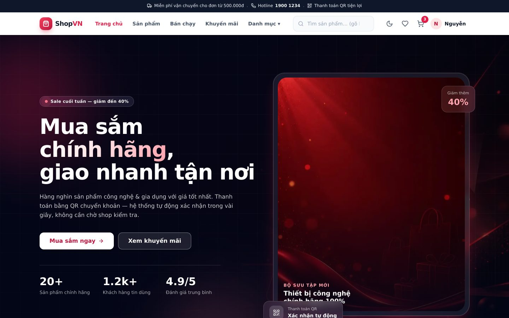](docs/screenshots/trang-chu.jpg) | [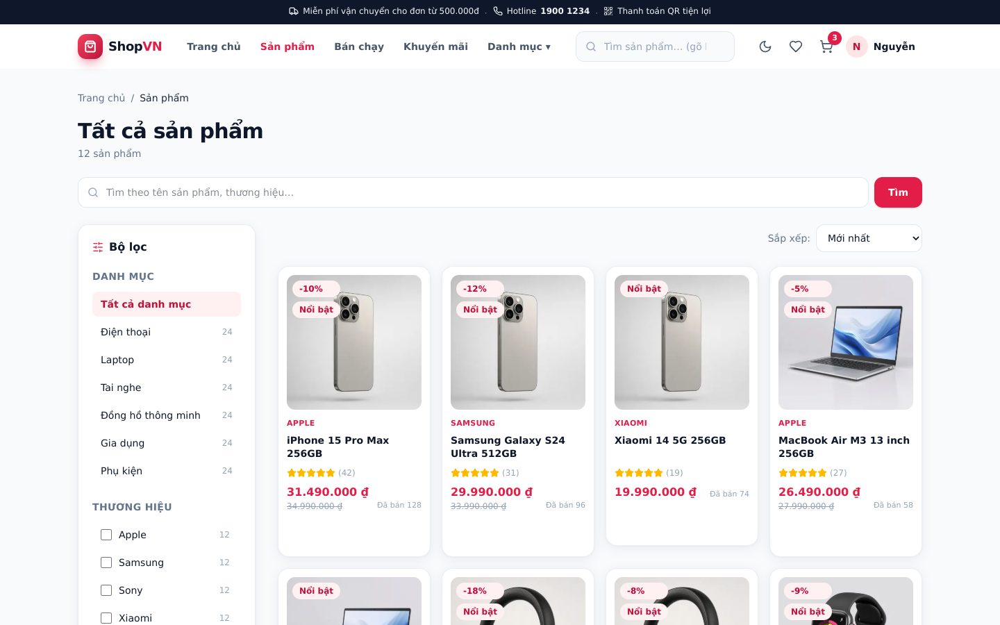](docs/screenshots/danh-sach-san-pham.jpg) |

| Chi tiết sản phẩm (biến thể, tồn kho) | Đánh giá sản phẩm — `?tab=reviews` |
|---|---|
| [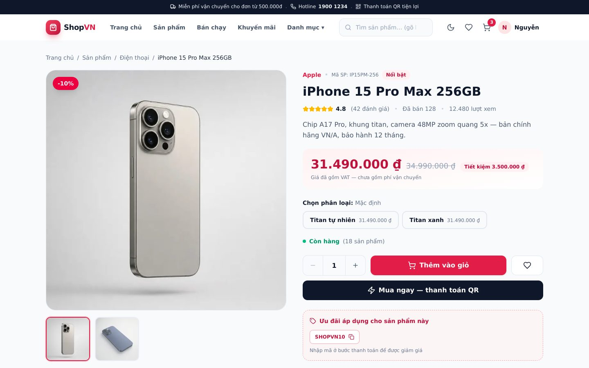](docs/screenshots/chi-tiet-san-pham.jpg) | [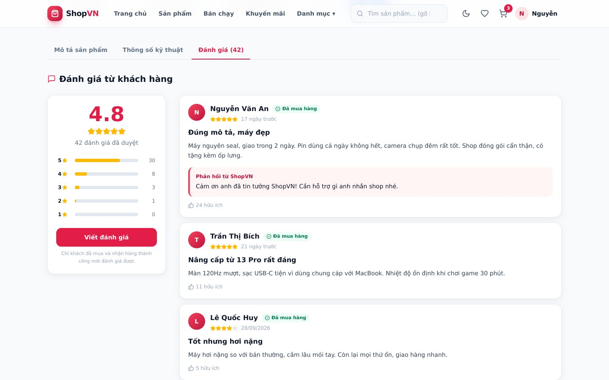](docs/screenshots/danh-gia-san-pham.jpg) |

| Giỏ hàng | Thanh toán 3 bước |
|---|---|
| [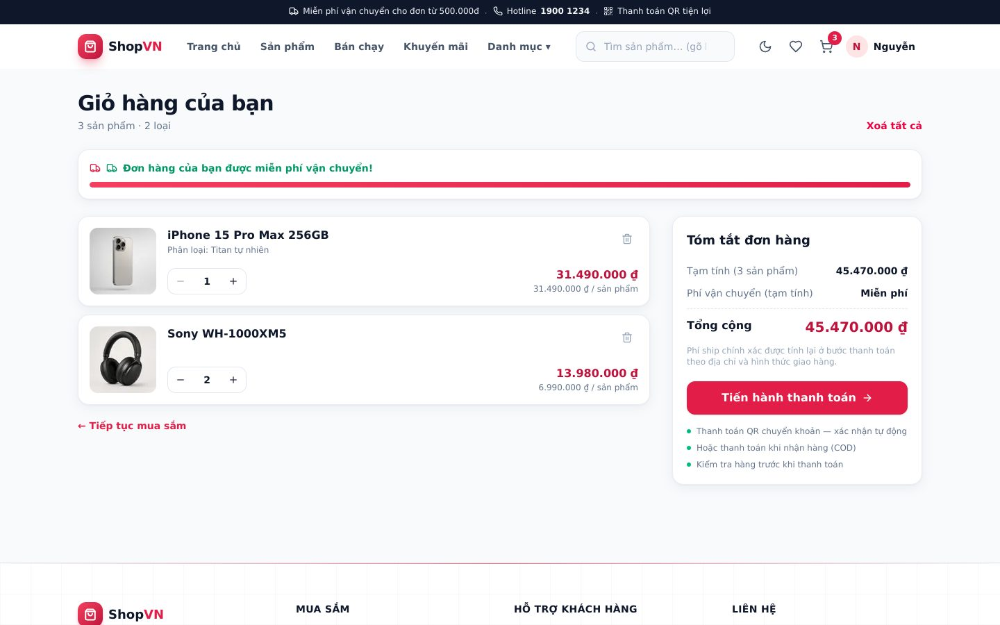](docs/screenshots/gio-hang.jpg) | [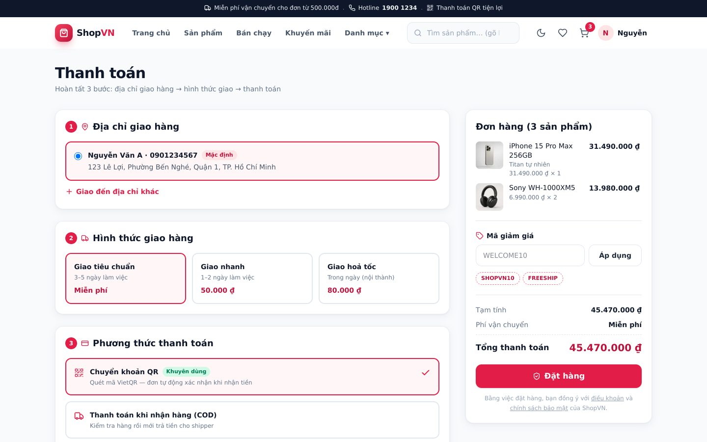](docs/screenshots/thanh-toan.jpg) |

| Đăng nhập | Đơn hàng của tôi (timeline trạng thái) |
|---|---|
| [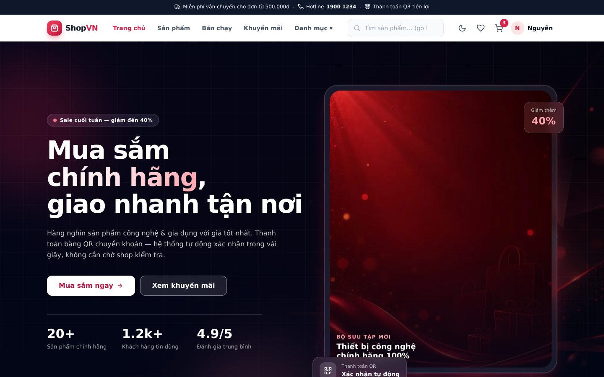](docs/screenshots/dang-nhap.jpg) | [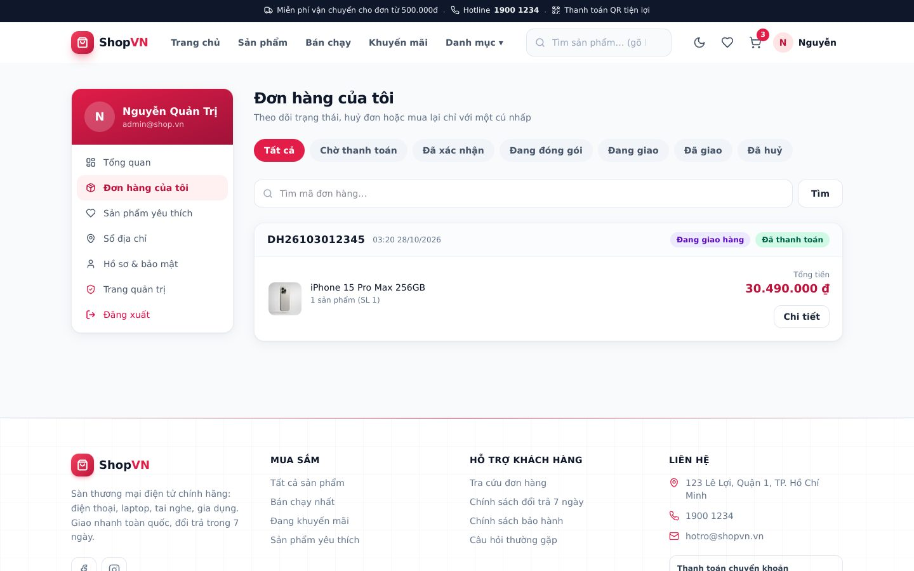](docs/screenshots/tai-khoan-don-hang.jpg) |

### Dành cho quản trị

| Bảng điều khiển KPI | Quản lý sản phẩm |
|---|---|
| [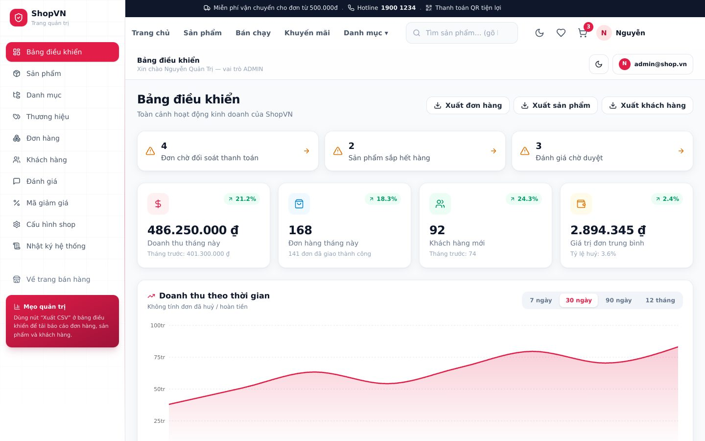](docs/screenshots/quan-tri-tong-quan.jpg) | [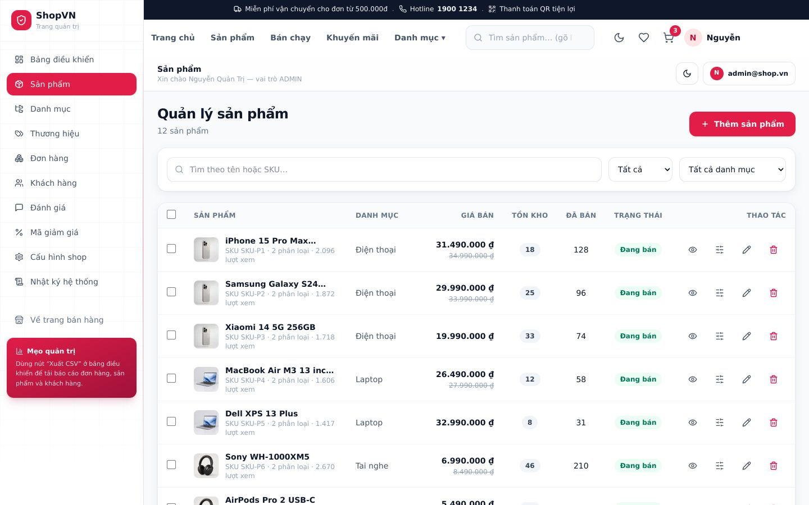](docs/screenshots/quan-tri-san-pham.jpg) |

| Quản lý đơn hàng | Cấu hình shop (phí ship, ngân hàng) |
|---|---|
| [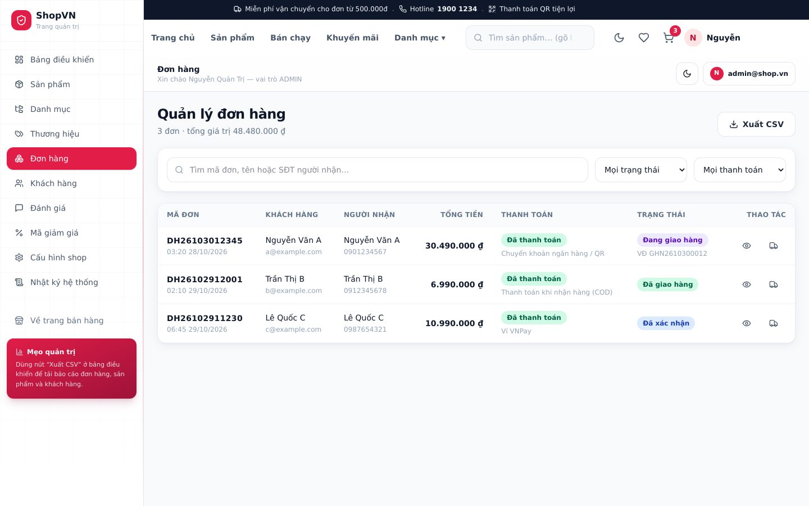](docs/screenshots/quan-tri-don-hang.jpg) | [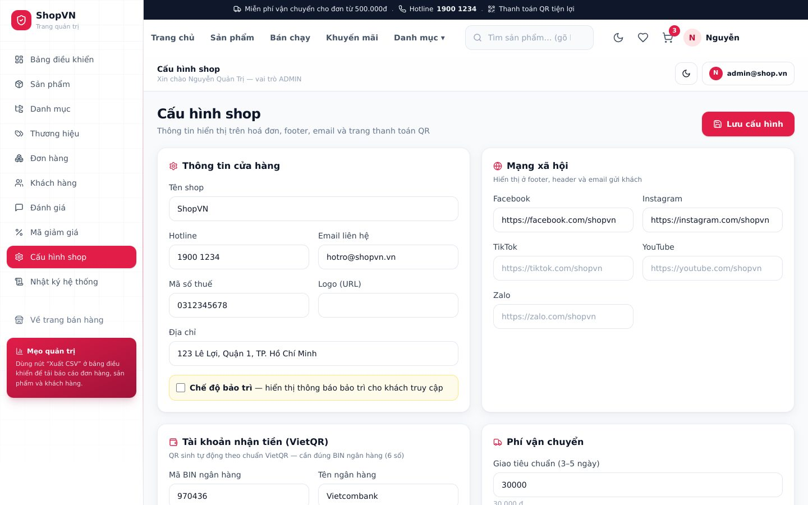](docs/screenshots/quan-tri-cau-hinh.jpg) |

<p align="center">
  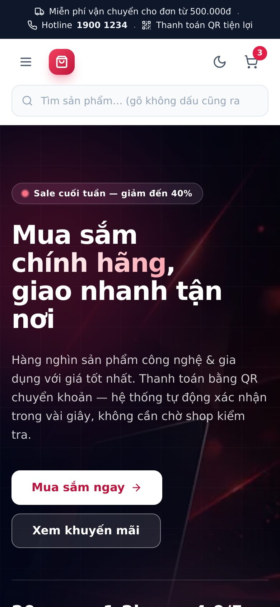
  <br><em>Giao diện di động — 390px (iPhone 13/14)</em>
</p>

Bộ **16 ảnh sản phẩm** (1000×1000) mà seed dùng nằm trong [`frontend/public/img/products/`](frontend/public/img/products) —
không phụ thuộc mạng ngoài.

---

## Đánh giá sản phẩm

Mỗi sản phẩm có tab **Đánh giá** ngay trên trang chi tiết, và tab này **đồng bộ với URL** nên chia sẻ được:

> 👉 **[Xem đánh giá — iPhone 15 Pro Max 256GB](http://localhost:3000/products/iphone-15-pro-max-256gb?tab=reviews)**
>
> Mở link sau khi đã `npm run seed` (đổi `localhost:3000` thành domain thật khi deploy).
> Link khác: [Sony WH-1000XM5](http://localhost:3000/products/sony-wh-1000xm5?tab=reviews) ·
> [MacBook Air M3](http://localhost:3000/products/macbook-air-m3-13-inch-256gb?tab=reviews)

Cơ chế:

| Điểm | Chi tiết |
|---|---|
| Chỉ người **đã mua** | Bắt buộc có đơn `DELIVERED` chứa sản phẩm → gắn huy hiệu **“Đã mua hàng”** (`isVerified`) |
| Mỗi người 1 đánh giá / sản phẩm | Gửi lại → `409`; vẫn **sửa** (`PATCH`) và **xoá** (`DELETE`) được |
| Kiểm duyệt | Đánh giá mới ở trạng thái `PENDING`, admin duyệt mới hiển thị (chống spam) |
| Nội dung | 1–5 sao, tiêu đề, nội dung ≥ 10 ký tự, tối đa **5 ảnh thực tế** (upload qua `/uploads/image`) |
| Hiển thị | Biểu đồ phân bố 5→1 sao, lọc theo số sao, huy hiệu “Đã mua hàng”, **admin trả lời** công khai (đếm “hữu ích” mới ở mức hiển thị, chưa có nút bình chọn) |

API: `GET /api/v1/reviews?productId=…` (công khai) · `POST /api/v1/reviews` · `PATCH /api/v1/reviews/:id` · `DELETE /api/v1/reviews/:id` ·
admin duyệt tại `PATCH /api/v1/admin/reviews/:id`.

---

## Số liệu dự án

| Hạng mục | Số lượng |
|---|---|
| Tổng dòng mã | **~17.300 dòng** (backend 6.932 · frontend 10.396) |
| API endpoint | **104** route (công khai + quản trị) |
| Model dữ liệu | **26** model Prisma · **37** index · có migration thật |
| Trang giao diện | **30** trang (17 khách hàng + 12 quản trị + phụ trợ) |
| Module backend | **15** module nghiệp vụ |
| Test backend | **43** test (Vitest) — có unit test cho công thức phí ship |
| Ảnh sản phẩm | **16** ảnh studio (1000×1000, baseline JPEG) |

---

## Kiến trúc

```
┌────────────────────────────┐        ┌──────────────────────────────┐
│  Frontend — Next.js 15     │        │  Backend — Express 5         │
│  React 19 · TypeScript     │  HTTP  │  Node 20 · TypeScript        │
│  Tailwind v4 · Radix UI    │ ─────► │  route → controller → service│
│  Zustand · TanStack Query  │  /api  │  Zod validate · JWT · pino   │
└────────────────────────────┘        └───────────────┬──────────────┘
         ▲                                            │ Prisma ORM
         │  rewrites /api/* → :4000                   ▼
         │                              ┌──────────────────────────────┐
         └──────────────────────────────│  PostgreSQL 16               │
             (Next proxy — cùng origin)│  26 model · 1 migration      │
                                        └──────────────────────────────┘
                                                       ▲
                    Cron 15' (huỷ đơn quá hạn)  ·  Redis 7 (tuỳ chọn: cache + rate limit)
```

**Vì sao tách backend riêng?** API độc lập khỏi giao diện (tái sử dụng được cho app di động), xử lý
webhook ngân hàng ở phía server, và thể hiện rõ kiến trúc phân lớp. Frontend gọi API qua **proxy của
Next.js** nên trình duyệt luôn thấy cùng origin → cookie phiên hoạt động an toàn, không cần CORS phức tạp.

### Cấu trúc thư mục

```
ecommerce-fullstack/
├── backend/
│   ├── prisma/
│   │   ├── schema.prisma         26 model (User, Product, Order, Payment…)
│   │   ├── migrations/           migration thật, chạy được trên máy sạch
│   │   └── seed.ts               dữ liệu mẫu: 20 sản phẩm, 6 danh mục, 8 đơn hàng
│   ├── scripts/                  doctor · predev · kiem-tra · bootstrap-env · db-check
│   └── src/
│       ├── config/               env (Zod), constants, swagger
│       ├── lib/                  cookies · jwt · redis · vietqr · mailer · crypto
│       ├── middlewares/          auth · role · validate · rateLimit · upload · error
│       ├── jobs/                 cron: huỷ đơn quá hạn · dọn dữ liệu
│       └── modules/              15 module: auth, products, cart, orders, payments,
│                                 webhooks, reviews, wishlist, coupons, users…
├── frontend/
│   ├── public/img/               4 ảnh nền + 16 ảnh sản phẩm (nằm trong repo)
│   └── src/
│       ├── app/                  30 trang (App Router)
│       ├── components/           layout · shop · admin · ui
│       ├── hooks/                useCategories · useDebounce · useMediaQuery
│       ├── store/                zustand: auth · cart · ui
│       └── lib/                  api client (tự refresh token khi 401) · format
├── docs/                         01→07: lộ trình, SRS, kiến trúc, bảo mật, setup, UI/UX
└── *.sh / *.cmd / *.ps1          script cài đặt & chạy (Windows + Git Bash)
```

---

## Công nghệ sử dụng

| Lớp | Công nghệ |
|---|---|
| **Frontend** | Next.js 15 (App Router) · React 19 · TypeScript strict · Tailwind CSS v4 · Radix UI · Framer Motion · Zustand · TanStack Query v5 · React Hook Form + Zod · Recharts · lucide-react · sonner |
| **Backend** | Node.js ≥ 20 · Express 5 · TypeScript (ESM) · Prisma 6 · PostgreSQL 16 · Zod · JWT · bcrypt · pino · Nodemailer · qrcode · sharp · node-cron · Swagger UI · Helmet |
| **Dữ liệu & hạ tầng** | PostgreSQL 16 · Redis 7 (tuỳ chọn) · Docker Compose · pgAdmin |
| **Kiểm thử** | Vitest · Supertest (unit/integration) · bộ kiểm tra tích hợp 29 mục (`kiem-tra.sh`) |

---

## Chạy dự án

### Cách 1 — Tự động (khuyến nghị)

**Windows:** nháy đúp `setup-windows.cmd` → sau đó nháy đúp `start-all.cmd`
**Git Bash / macOS / Linux:**

```bash
bash setup-gitbash.sh    # cài đặt: DB, .env (tự sinh khoá bí mật), migrate, seed
bash start-all.sh        # bật API + web, tự kiểm tra trước khi chạy
```

Một lệnh này tự làm: kiểm tra Node & Docker → bật PostgreSQL → tạo/sửa `backend/.env` (sinh khoá bí
mật nếu còn là giá trị mẫu) → `npm install` nếu thiếu → `prisma generate` **(kiểm tra thật, không tin
file có sẵn)** → migrate + seed → chạy nền API + web → ghi log vào `logs/`.

### Cách 2 — Thủ công

```bash
# 1) Database
docker compose up -d                 # PostgreSQL 16 (+ Redis 7)

# 2) Biến môi trường (KHÔNG dùng khoá mẫu khi triển khai thật)
cp .env.example backend/.env

# 3) Backend
cd backend
npm install
npx prisma generate && npx prisma migrate deploy
npm run db:extensions && npm run seed
npm run dev                          # http://localhost:4000 · Swagger /api/docs

# 4) Frontend (terminal khác)
cd frontend && npm install && npm run dev    # http://localhost:3000
```

### Địa chỉ & tài khoản

| Dịch vụ | URL |
|---|---|
| Giao diện | http://localhost:3000 |
| API | http://localhost:4000/api/v1 |
| Swagger UI | http://localhost:4000/api/docs |
| pgAdmin | http://localhost:5050 |

| Vai trò | Email | Mật khẩu |
|---|---|---|
| Quản trị viên | `admin@shop.vn` | `Admin@123456` |
| Khách hàng | `customer@shop.vn` | `Customer@123456` |

### Lệnh thường dùng

| Lệnh | Việc |
|---|---|
| `bash start-all.sh` | Bật toàn hệ thống (tự kiểm tra trước) |
| `bash stop-all.sh` | Tắt sạch API + web (giết cả tiến trình con) |
| `bash kiem-tra.sh` | **Tự kiểm tra 29 mục**: API, DB, phân quyền, 18 trang web |
| `bash xem-log.sh` | Xem log đang chạy |
| `bash chan-doan.sh` | Chẩn đoán khi web không mở lên |
| `cd backend && npm run doctor` | Kiểm tra môi trường (Node, Docker, cổng, DB) |
| `cd backend && npm test` | Chạy 43 unit test |
| `cd backend && npx prisma studio` | Xem/sửa dữ liệu bằng giao diện |
| `cd backend && npx prisma migrate reset --force` | Xoá sạch → nạp lại dữ liệu mẫu |

---

## Biến môi trường

Toàn bộ nằm trong [`​.env.example`](.env.example) (script cài đặt tự sinh khoá bí mật cho bạn).
Các nhóm chính:

| Nhóm | Biến |
|---|---|
| Ứng dụng | `NODE_ENV` · `PORT` · `API_PREFIX` · `APP_NAME` · `CLIENT_URL` · `CORS_ORIGIN` |
| Dữ liệu | `DATABASE_URL` · `REDIS_URL` *(tuỳ chọn)* |
| Xác thực | `JWT_ACCESS_SECRET` · `JWT_REFRESH_SECRET` · `ACCESS_TOKEN_TTL` · `REFRESH_TOKEN_TTL` · `COOKIE_DOMAIN` · `COOKIE_SECURE` · `BCRYPT_ROUNDS` |
| Email | `MAIL_DRIVER` *(console \| smtp \| resend)* · `SMTP_*` · `MAIL_FROM` · `RESEND_API_KEY` |
| Google OAuth | `GOOGLE_CLIENT_ID` · `GOOGLE_CLIENT_SECRET` · `GOOGLE_CALLBACK_URL` |
| Ngân hàng / VietQR | `BANK_BIN` · `BANK_ACCOUNT_NO` · `BANK_ACCOUNT_NAME` · `BANK_NAME` · `WEBHOOK_SECRET` · `ORDER_PAYMENT_TTL_MINUTES` |
| Vận chuyển | `FREE_SHIPPING_THRESHOLD` · `SHIPPING_FEE_STANDARD` · `SHIPPING_FEE_EXPRESS` · `SHIPPING_FEE_INSTANT` |
| Upload | `STORAGE_DRIVER` · `UPLOAD_DIR` · `MAX_FILE_SIZE_MB` · `PUBLIC_UPLOAD_URL` |
| Chống spam | `RATE_LIMIT_WINDOW_MIN` · `RATE_LIMIT_MAX` · `RATE_LIMIT_LOGIN_MAX` · `TRUST_PROXY` |
| Dữ liệu mẫu | `SEED_ADMIN_EMAIL` · `SEED_ADMIN_PASSWORD` · `SEED_USER_EMAIL` · `SEED_USER_PASSWORD` |

> **Lưu ý về `TRUST_PROXY`:** khi web gọi API qua proxy của Next.js, mọi người truy cập có thể mang
> cùng một IP ⇒ nếu để ngưỡng chống spam thấp, cả website sẽ dùng chung hạn mức và bị chặn oan.
> Bật `TRUST_PROXY=true` để lấy IP thật từ `X-Forwarded-For` (chỉ bật khi API không lộ trực tiếp ra
> internet, vì header này có thể bị giả mạo).

---

## Tính năng

### Khách hàng
Đăng ký · đăng nhập · **quên & đặt lại mật khẩu** · xác thực email · **đăng nhập Google** · xem phiên thiết bị
· tìm kiếm **không dấu** · lọc theo danh mục/thương hiệu/khoảng giá, sắp xếp (đồng bộ vào URL) · danh sách
yêu thích · giỏ hàng (**hoạt động cả khi chưa đăng nhập — tự gộp vào tài khoản khi đăng nhập**) · checkout
3 bước · **thanh toán QR chuyển khoản** hoặc COD · mã giảm giá · theo dõi đơn có timeline · huỷ đơn / mua lại
/ yêu cầu trả hàng · đánh giá sản phẩm · hồ sơ & sổ địa chỉ

### Quản trị
Bảng điều khiển KPI + biểu đồ · CRUD sản phẩm (nhiều ảnh, biến thể, điều chỉnh tồn kho, thao tác hàng loạt)
· CRUD danh mục / thương hiệu / mã giảm giá · quản lý đơn (đổi trạng thái có kiểm tra hợp lệ, xác nhận
thanh toán thủ công) · quản lý người dùng (khoá/mở, đổi vai trò) · duyệt đánh giá · thống kê & **export CSV**
· cấu hình shop + **liên kết mạng xã hội** · **nhật ký hệ thống (audit log)**

### Vòng đời đơn hàng
`PENDING_PAYMENT → CONFIRMED → PACKING → SHIPPING → DELIVERED`
nhánh huỷ: `CANCELLED` · nhánh trả hàng: `RETURN_REQUESTED → RETURNED → REFUNDED` (9 trạng thái, mọi thay
đổi đều ghi log kèm người thực hiện).

---

## API

Base URL: `/api/v1` · Tài liệu tương tác: **http://localhost:4000/api/docs** (Swagger UI, có nút *Try it out*)

| Nhóm | Endpoint (rút gọn) |
|---|---|
| `auth` | `POST /register` · `/login` · `/refresh` · `/logout` · `/forgot-password` · `/reset-password` · `/verify-email` · `GET /me` · `PATCH /me` · `GET /sessions` · `GET /google` |
| `products` | `GET /products` (search, lọc, sắp xếp, phân trang) · `/products/:slug` · `/related` · `/featured` · `/best-sellers` · `/newest` · `/suggestions` |
| `categories` · `brands` | `GET /categories` (dạng cây) · `/categories/:slug` · `GET /brands` |
| `cart` | `GET /cart` · `POST /cart/items` · `PATCH /cart/items/:id` · `DELETE /cart/items/:id` · `POST /cart/merge` |
| `wishlist` · `addresses` | `GET/POST/DELETE /wishlist` · CRUD `/addresses` |
| `orders` | `POST /orders` · `GET /orders` · `GET /orders/:code` · `POST /orders/:code/cancel` · `POST /orders/:code/reorder` · `POST /orders/:code/return` |
| `payments` | `GET /payments/:orderCode/qr.png` · trạng thái thanh toán · xác nhận thủ công (admin) |
| `reviews` | `GET /reviews?productId=` · `POST /reviews` · duyệt đánh giá (admin) |
| `coupons` | `GET /coupons/available` · kiểm tra mã giảm giá |
| `webhooks` | `POST /webhooks/bank` — ngân hàng báo có, **xác thực HMAC-SHA256**, chống trùng lặp |
| `admin` | 19 endpoint: thống kê, quản lý sản phẩm/đơn/người dùng/đánh giá/mã giảm giá, cấu hình shop, audit log, export CSV |
| `uploads` | `POST /uploads/image` (1 ảnh) · `POST /uploads/images` (nhiều ảnh — field `files` hoặc `images`) · `DELETE /uploads` (admin) — ảnh đã resize 3 cỡ + tước EXIF |

**Chuẩn phản hồi:**

```jsonc
// Thành công
{ "success": true, "message": "Lấy danh sách sản phẩm thành công",
  "data": [ /* ... */ ],
  "meta": { "page": 1, "limit": 24, "total": 20, "totalPages": 1 } }

// Lỗi
{ "success": false, "message": "Email đã được sử dụng", "code": "EMAIL_EXISTS",
  "errors": [{ "field": "email", "message": "Email đã được sử dụng" }] }
```

---

## Bảo mật

| Hạng mục | Cách làm |
|---|---|
| Mật khẩu | Băm **bcrypt** (12 rounds), không lưu bản gốc, không ghi vào log |
| Phiên đăng nhập | JWT trong **cookie httpOnly** + `SameSite=Lax`; refresh token **rotation**, phát hiện tái sử dụng → thu hồi cả họ token + gửi email cảnh báo; token trong DB lưu **hash SHA-256** |
| CSRF | Double-submit cookie (`csrf_token` + header `x-csrf-token`) cho mọi thao tác ghi |
| Phân quyền | 3 tầng: `requireAuth` → `requireRole('ADMIN')` → kiểm tra quyền sở hữu trong service (chống **IDOR**: `order.userId !== userId → 404`) |
| Dữ liệu đầu vào | **Zod** kiểm tra body/query/params mọi request; Prisma tham số hoá → chống SQL injection |
| Chống spam | Giới hạn theo nhóm endpoint: đăng nhập, đăng ký, quên mật khẩu, tạo đơn, upload, đánh giá |
| Upload | Whitelist MIME + magic bytes, giới hạn 5 MB, resize bằng sharp, tước EXIF |
| Webhook ngân hàng | HMAC-SHA256 so sánh **timing-safe** + chống xử lý trùng (idempotent) + transaction |
| Header bảo mật | Helmet + CSP; production bật HSTS; lỗi không lộ stack trace |
| Toàn vẹn dữ liệu | Trừ kho nguyên tử chống oversell; transaction cho đơn hàng; cron hoàn kho khi huỷ đơn |

Chi tiết đối chiếu **OWASP Top 10**: [`docs/04-BAO-MAT-VA-TICH-HOP.md`](docs/04-BAO-MAT-VA-TICH-HOP.md)

---

## Kiểm thử & chất lượng

```bash
cd backend && npm test          # 36/36 unit test pass (Vitest)
cd backend && npm run typecheck # tsc --noEmit → 0 lỗi
cd frontend && npm run typecheck && npm run build
bash kiem-tra.sh                # 29 mục: API, DB, phân quyền, 18 trang web
```

Kết quả hiện tại:

| Bài kiểm tra | Kết quả |
|---|---|
| Unit test backend (Vitest) | ✅ **36/36 pass** |
| TypeScript backend + frontend | ✅ 0 lỗi |
| `next build` | ✅ pass — 28 route dựng tĩnh |
| Tự kiểm tra tích hợp | ✅ **29/29 đạt** |
| Kiểm thử qua trình duyệt *(dùng khi phát triển)* | ✅ 15 tuyến quản trị + khách **0 lỗi console**; đã kiểm cả trên iPhone 13 (390px). *Playwright là công cụ kiểm thử lúc phát triển, không kèm trong repo — bộ kiểm tra chính thức là `kiem-tra.sh` + Vitest.* |

---

## Tài liệu

| File | Nội dung |
|---|---|
| [`BAT-DAU-O-DAY.md`](BAT-DAU-O-DAY.md) | Chạy nhanh trong 3 bước + bảng lỗi thường gặp |
| [`HUONG-DAN-SETUP.md`](HUONG-DAN-SETUP.md) | Hướng dẫn chính thức A→Z: chuẩn bị, cài đặt, kiểm tra, 12 lỗi thường gặp |
| [`DEMO-10-PHUT.md`](DEMO-10-PHUT.md) | Kịch bản demo 10 phút · phương án dự phòng · **20 câu hỏi thường gặp khi bảo vệ** |
| [`VSCODE.md`](VSCODE.md) | Chạy & debug bằng VS Code (22 task, F5 có breakpoint) |
| [`WINDOWS-SETUP.md`](WINDOWS-SETUP.md) | Chi tiết cài trên Windows + Docker |
| [`BUILD-INFO.txt`](BUILD-INFO.txt) | Nhật ký các bản dựng và lỗi đã sửa qua từng phiên bản |
| [`docs/01`](docs/01-LO-TRINH-ROADMAP.md) | Lộ trình 10 tuần / 8 phase, checklist tiến độ, rủi ro |
| [`docs/02`](docs/02-YEU-CAU-CHUC-NANG.md) | SRS: 90+ yêu cầu có mã, tiêu chí chấp nhận, user story, ma trận RBAC |
| [`docs/03`](docs/03-KIEN-TRUC-VA-DATABASE.md) | Kiến trúc, ADR, ERD, thiết kế Prisma, danh sách endpoint, sequence diagram |
| [`docs/04`](docs/04-BAO-MAT-VA-TICH-HOP.md) | OWASP checklist, token rotation, VietQR/EMVCo, email, OAuth |
| [`docs/05`](docs/05-SETUP-VA-YEU-CAU.md) | Yêu cầu môi trường, API key cần chuẩn bị, xử lý sự cố |
| [`docs/06`](docs/06-UI-UX-DESIGN-SYSTEM.md) | Design system: token màu/chữ/khoảng cách, component, animation, a11y |
| [`docs/07`](docs/07-HUONG-DAN-CAI-DAT-VA-CHAY-DU-AN.md) | Hướng dẫn cài đặt & bàn giao chi tiết |

---

## Xử lý sự cố nhanh

| Hiện tượng | Cách xử lý |
|---|---|
| Web không mở lên / trắng trang | `bash chan-doan.sh` → làm theo hướng dẫn; nhanh nhất: `bash stop-all.sh` rồi `bash start-all.sh` |
| Báo `@prisma/client did not initialize yet` | Script đã tự phát hiện bản giả và tự `prisma generate`; nếu vẫn lỗi xem `logs/prisma-generate.log` |
| Cổng 3000/4000 đang bị chiếm | `bash stop-all.sh` (tắt sạch cả tiến trình con), sau đó `bash start-all.sh` |
| Docker Engine chưa chạy | Mở Docker Desktop, đợi Engine khởi động rồi chạy lại `bash start-all.sh` |
| Bị chặn 429 quá nhiều request | Tăng `RATE_LIMIT_MAX` trong `backend/.env` rồi khởi động lại API |
| Muốn xoá sạch dữ liệu về ban đầu | `cd backend && npx prisma migrate reset --force` |
| Máy yếu, web tự tắt khi mở trang quản trị | `start-all.sh` tự chuyển chế độ production khi RAM < 3 GB; có thể ép bằng `bash start-all.sh prod` |

Danh sách đầy đủ 12 lỗi thường gặp: [`HUONG-DAN-SETUP.md`](HUONG-DAN-SETUP.md) mục 8.

---

## Giấy phép

[MIT](LICENSE) — dùng tự do cho mục đích học tập & portfolio.
