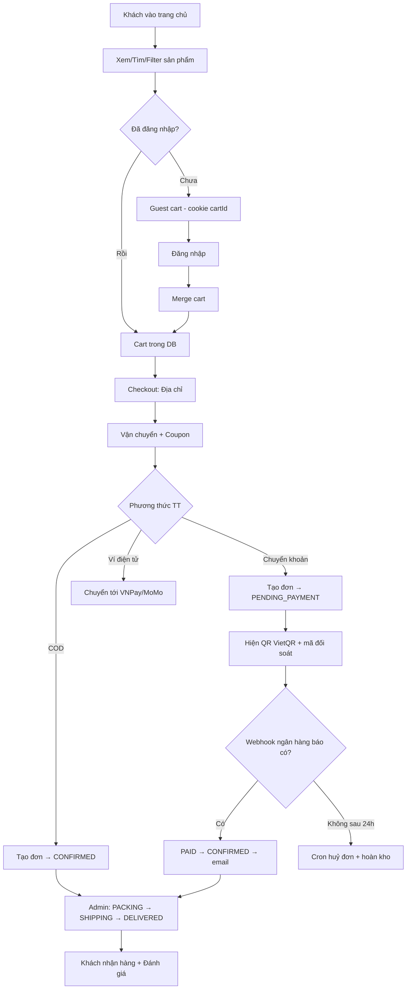

# 📋 ĐẶC TẢ YÊU CẦU CHỨC NĂNG (SRS)

> Phiên bản 1.0 · Phạm vi: **v1 — sàn TMĐT đa danh mục, một người bán (single-vendor)**

---

## 0. Ngoài phạm vi (KHÔNG làm ở v1) — ghi rõ để tránh nổ scope

❌ Đa vendor / marketplace  ❌ App mobile native  ❌ Đa ngôn ngữ (i18n)
❌ Chat realtime với shop  ❌ Livestream  ❌ Hệ thống gợi ý bằng ML
❌ Loyalty/điểm thưởng     ❌ Đa kho / đa chi nhánh  ❌ Kế toán, xuất hoá đơn điện tử VAT

> Ghi mục này vào README. Người phỏng vấn sẽ hỏi "sao không làm X" — bạn trả lời: *"Tôi chủ động cắt để v1 hoàn thiện thay vì nửa vời; X nằm trong roadmap v2."*

---

## 1. Tác nhân (Actors)

| Actor | Mô tả | Quyền |
|---|---|---|
| **Guest** | Chưa đăng nhập | Xem sản phẩm, tìm kiếm, lọc, xem đánh giá, thêm vào giỏ (guest cart), checkout (bắt buộc đăng nhập ở bước cuối) |
| **Customer** | Đã đăng nhập, role `CUSTOMER` | Toàn bộ của Guest + quản lý đơn, wishlist, profile, đánh giá sản phẩm đã mua |
| **Admin** | role `ADMIN` | Toàn quyền quản trị: sản phẩm, đơn, người dùng, thống kê, coupon, cấu hình |
| **Hệ thống** | Cron / Webhook | Hủy đơn quá hạn, tự xác nhận thanh toán, gửi email, dọn token hết hạn |
| **Cổng thanh toán / Ngân hàng** | Bên ngoài | Gửi webhook xác nhận giao dịch |

---

## 2. Yêu cầu chức năng — CUSTOMER

### 2.1 Xác thực & tài khoản

| ID | Chức năng | Mô tả chi tiết | Tiêu chí chấp nhận (AC) |
|---|---|---|---|
| AUTH-01 | **Đăng ký** | Email + mật khẩu + họ tên + SĐT | Email chưa tồn tại → tạo user role CUSTOMER, gửi mail verify. Mật khẩu ≥8 ký tự, có chữ hoa + số + ký tự đặc biệt. Lỗi trả về theo field, không lộ thông tin hệ thống |
| AUTH-02 | **Xác thực email** | Link `/verify-email?token=` | Token hợp lệ & chưa dùng & chưa hết hạn (24h) → `emailVerified=true`. Hết hạn → có nút gửi lại (tối đa 3 lần/giờ) |
| AUTH-03 | **Đăng nhập** | Email + mật khẩu | Đúng → set cookie `access_token` (15') + `refresh_token` (7d), redirect theo intent. Sai → thông báo chung "Email hoặc mật khẩu không đúng" (không nói rõ cái nào sai). Sai 5 lần → khoá 15 phút |
| AUTH-04 | **Duy trì phiên** | Refresh token rotation | Access hết hạn → tự động refresh ngầm, user không thấy gián đoạn. Refresh bị tái sử dụng → **thu hồi toàn bộ session của user** + email cảnh báo bảo mật |
| AUTH-05 | **Đăng xuất** | – | Xoá cookie + revoke refresh token hiện tại. Có thêm "Đăng xuất khỏi mọi thiết bị" |
| AUTH-06 | **Quên mật khẩu** | Nhập email | LUÔN trả 200 dù email có tồn tại hay không. Nếu tồn tại → gửi mail link reset (TTL 15'), các token cũ bị vô hiệu |
| AUTH-07 | **Đặt lại mật khẩu** | Token + mật khẩu mới | Token dùng 1 lần, hết hạn 15'. Thành công → revoke mọi session + gửi mail "mật khẩu đã đổi" |
| AUTH-08 | **Đổi mật khẩu** | Mật khẩu cũ + mới | Phải xác thực mật khẩu cũ. Mật khẩu mới ≠ cũ. Revoke các session khác |
| AUTH-09 | **Đăng nhập Google** | OAuth 2.0 | Lần đầu → tự tạo tài khoản (email đã verify), liên kết vào bảng `Account`. Đã có email trùng → liên kết provider vào tài khoản cũ |
| AUTH-10 | **Quản lý phiên** | Danh sách thiết bị đang đăng nhập | Hiển thị thiết bị / IP / thời gian / lần cuối hoạt động; thu hồi từng phiên |

### 2.2 Sản phẩm & tìm kiếm

| ID | Chức năng | Chi tiết | AC |
|---|---|---|---|
| PROD-01 | **Danh sách sản phẩm** | Lưới responsive 2/3/4 cột | Ảnh tỷ lệ 1:1, lazy load, có badge (Mới / -30% / Hết hàng), skeleton khi tải |
| PROD-02 | **Chi tiết sản phẩm** | Gallery nhiều ảnh + zoom, mô tả, thông số, biến thể | Đổi biến thể → giá & tồn kho cập nhật ngay. Có sản phẩm liên quan & đã xem gần đây |
| SEARCH-01 | **Tìm kiếm** | Ô search header | Debounce 300ms, gợi ý dropdown 5 kết quả có ảnh + giá, hỗ trợ **không dấu** (gõ "dien thoai" ra "điện thoại"), highlight từ khóa, lịch sử tìm kiếm |
| FILTER-01 | **Lọc** | Sidebar (desktop) / bottom sheet (mobile) | Lọc theo: danh mục (cây), thương hiệu, khoảng giá (slider 2 đầu + input), đánh giá ≥, còn hàng, có giảm giá. Đếm số lượng mỗi filter. **Trạng thái filter nằm trên URL** |
| FILTER-02 | **Sắp xếp** | Dropdown | Mới nhất · Bán chạy · Giá ↑ · Giá ↓ · Đánh giá cao · Giảm giá nhiều |
| FILTER-03 | **Phân trang** | Server-side | Trả `meta.total`; có nút chuyển nhanh; giữ nguyên filter khi chuyển trang |
| PROD-03 | **Biến thể** | Ví dụ: 128GB / 256GB, Đen / Trắng | Ảnh riêng theo biến thể, tồn kho riêng, giá riêng (giá = giá gốc + delta) |

### 2.3 Giỏ hàng · Yêu thích · Địa chỉ

| ID | Chức năng | Chi tiết | AC |
|---|---|---|---|
| CART-01 | **Giỏ hàng** | Mini-cart drawer + trang /cart | Thêm/sửa SL/xoá, optimistic update, badge số lượng ở header có bounce |
| CART-02 | **Guest cart** | Chưa đăng nhập vẫn thêm được | Lưu bằng `cartId` cookie 30 ngày. **Đăng nhập → tự merge** vào giỏ DB (cộng dồn SL, không mất item) |
| CART-03 | **Kiểm tra tồn kho** | Trước khi checkout | Vượt `stock` → chặn + thông báo "chỉ còn N sản phẩm". Kiểm tra lại lần cuối trong `$transaction` khi tạo đơn |
| CART-04 | **Tính tiền** | Realtime | Tạm tính, phí ship (freeship ≥ 500k), giảm giá, tổng. Mọi số đều **tính lại ở server** khi tạo đơn (không tin client) |
| WISH-01 | **Wishlist** | Trái tim trên card & detail | Yêu cầu đăng nhập; guest bấm → mở modal đăng nhập. Có nút "chuyển tất cả vào giỏ" |
| ADDR-01 | **Sổ địa chỉ** | CRUD | Tỉnh/Quận/Phường chọn từ danh mục; đặt mặc định; tối đa 10 địa chỉ |
| COUP-01 | **Mã giảm giá** | Nhập mã ở cart/checkout | Validate ngay, hiện lỗi rõ: "Mã đã hết hạn" / "Đơn tối thiểu 200.000đ" / "Mã đã dùng hết lượt". Hiện dòng giảm giá âm màu xanh |

### 2.4 Đặt hàng & thanh toán

| ID | Chức năng | Chi tiết | AC |
|---|---|---|---|
| CHK-01 | **Checkout 3 bước** | Stepper có animation | Bước 1 địa chỉ → 2 vận chuyển + coupon → 3 thanh toán. Có thể quay lại sửa. Validate từng bước |
| CHK-02 | **Chọn vận chuyển** | 3 mức | Tiêu chuẩn 30k (3–5 ngày) · Nhanh 50k (1–2 ngày) · Hỏa tốc 80k (nội thành, trong ngày). Freeship cho đơn ≥ 500k ở mức Tiêu chuẩn |
| PAY-01 | **COD** | Thanh toán khi nhận hàng | Đơn vào `CONFIRMED` ngay, `paymentStatus = UNPAID` |
| PAY-02 | **Chuyển khoản + QR** | Trọng tâm dự án | Sau khi đặt: hiện QR VietQR, STK, số tiền, **nội dung CK = mã đơn**, đếm ngược 24h, nút Copy từng dòng, nút tải QR về máy. Trạng thái `PENDING_PAYMENT` |
| PAY-03 | **Xác nhận đã CK** | Nút "Tôi đã chuyển khoản" | → `paymentStatus = PENDING_REVIEW`, admin thấy trong danh sách chờ duyệt |
| PAY-04 | **Tự động đối soát** | Webhook ngân hàng | Nhận callback → verify HMAC → match `transferCode` trong nội dung → đúng số tiền → `PAID` + `CONFIRMED` + gửi email. Sai số tiền → ghi nhận `UNDERPAID` và cảnh báo admin |
| PAY-05 | **Đơn hết hạn** | Cron 15 phút | `PENDING_PAYMENT` quá 24h → `CANCELLED` + hoàn kho + email thông báo |
| PAY-06 | **Hoá đơn** | Trang xác nhận + email | Mã đơn, danh sách SP, phí, tổng, địa chỉ giao, PTTT, QR (nếu CK). Nút In / Lưu PDF |

### 2.5 Đơn hàng & hồ sơ

| ID | Chức năng | Chi tiết | AC |
|---|---|---|---|
| ORD-01 | **Danh sách đơn** | Tabs theo trạng thái | Tabs: Chờ thanh toán / Đã xác nhận / Đang giao / Đã giao / Đã hủy / Trả hàng. Có search theo mã đơn |
| ORD-02 | **Chi tiết đơn** | Timeline dọc có animation | Mỗi mốc: trạng thái + thời gian + ghi chú. Sản phẩm, địa chỉ giao, thanh toán, tổng tiền |
| ORD-03 | **Hủy đơn** | Khi `PENDING_PAYMENT`/`CONFIRMED` | Nhập lý do → `CANCELLED` + hoàn kho + email. Không hủy được khi đã `SHIPPING` |
| ORD-04 | **Mua lại** | Re-order | Đưa toàn bộ item vào giỏ (bỏ item đã ngừng bán, báo rõ item nào bị bỏ) |
| ORD-05 | **Trả hàng** | `DELIVERED` trong 7 ngày | Tạo yêu cầu + lý do + ảnh → admin duyệt → `RETURN_REQUESTED` |
| REV-01 | **Đánh giá** | Chỉ người đã mua | 1 đánh giá/sản phẩm/đơn. Sao 1–5 + nội dung + ảnh (≤5). Có trạng thái chờ duyệt. Sửa/xoá trong 24h |
| PRO-01 | **Hồ sơ** | Họ tên, SĐT, ngày sinh, giới tính, avatar | Upload avatar (crop 1:1), validate SĐT VN |
| PRO-02 | **Bảo mật tài khoản** | Đổi mật khẩu, quản lý phiên, xoá tài khoản | Xoá tài khoản = soft delete + ẩn PII, giữ lại đơn hàng cho thống kê |

---

## 3. Yêu cầu chức năng — ADMIN

### 3.1 Dashboard & thống kê

| ID | Chức năng | Chi tiết |
|---|---|---|
| DASH-01 | **KPI cards** | Doanh thu hôm nay/tuần/tháng, số đơn, khách mới, giá trị đơn TB, tỷ lệ huỷ đơn. Có so sánh % với kỳ trước (mũi tên xanh/đỏ) + animation đếm số |
| DASH-02 | **Biểu đồ doanh thu** | Line/area chart 7/30/90 ngày, có tooltip, có thể đổi khoảng thời gian |
| DASH-03 | **Biểu đồ trạng thái đơn** | Donut chart: chờ TT / đã xác nhận / đang giao / hoàn thành / đã huỷ |
| DASH-04 | **Top sản phẩm** | Top 5 bán chạy (theo SL & doanh thu), top 5 xem nhiều |
| DASH-05 | **Cảnh báo** | Sắp hết hàng (stock ≤ 5), đơn chờ duyệt thanh toán (N đơn), đánh giá chờ duyệt |
| STAT-01 | **Thống kê chuyên sâu** | Doanh thu theo danh mục / thương hiệu / tháng / quý; khách hàng mua nhiều nhất (top 10 theo tổng chi tiêu); tỷ lệ chuyển đổi (đơn / lượt xem); **export CSV & Excel** |
| STAT-02 | **Báo cáo lọc** | Chọn khoảng ngày → mọi số liệu & biểu đồ cập nhật theo |

### 3.2 Quản trị

| ID | Chức năng | Chi tiết |
|---|---|---|
| ADM-PROD | **Product CRUD** | Bảng có sort mọi cột, search, filter theo danh mục/trạng thái, **bulk action** (ẩn/hiện/xoá nhiều). Form drawer: tên, slug (auto), SKU, mô tả rich text, giá, giá KM, tồn kho, danh mục, thương hiệu, tags, SEO meta, **upload nhiều ảnh kéo-thả có preview & sắp xếp**, quản lý biến thể |
| ADM-CAT | **Category CRUD** | Dạng cây, kéo thả đổi thứ tự, ảnh đại diện, slug, SEO, ẩn/hiện |
| ADM-BRAND | **Brand CRUD** | Tên, slug, logo, mô tả |
| ADM-ORD | **Order management** | Bảng + filter (trạng thái, ngày, PTTT, khoảng tiền). Xem chi tiết. **Cập nhật trạng thái có validate state machine** + ghi chú. Xác nhận thanh toán thủ công (kèm ảnh bill). In hoá đơn. Xử lý yêu cầu trả hàng |
| ADM-USER | **User management** | Danh sách + search + filter (role, trạng thái, ngày ĐK). Xem chi tiết: tổng đơn, tổng chi tiêu, đơn gần nhất. **Khoá/mở khoá**, đổi role, reset mật khẩu (gửi mail) |
| ADM-REV | **Review moderation** | Danh sách chờ duyệt, duyệt / ẩn / xoá + phản hồi của shop |
| ADM-COUP | **Coupon CRUD** | Mã, loại (% hoặc số tiền cố định), giá trị, đơn tối thiểu, giảm tối đa, số lượt, thời gian, áp dụng cho danh mục nào, bật/tắt |
| ADM-SET | **Settings** | Tên shop, logo, hotline, email, địa chỉ, **thông tin ngân hàng (dùng sinh QR)**, các mức phí ship, ngưỡng freeship, **liên kết mạng xã hội (Facebook, Instagram, TikTok, YouTube, Zalo)**, banner trang chủ, SEO mặc định |
| ADM-LOG | **Audit log** | Ghi lại hành động admin: ai, làm gì, lúc nào, trên đối tượng nào, dữ liệu trước/sau |

---

## 4. Yêu cầu phi chức năng (NFR)

| Nhóm | Yêu cầu | Cách đo |
|---|---|---|
| **Hiệu năng** | LCP < 2.5s, TTI < 3.5s trên 4G mobile | Lighthouse / PageSpeed |
| | API p95 < 300ms (không tính upload) | Log pino + kiểm tra thủ công |
| | Trang danh sách sản phẩm: lazy load ảnh, 24 item/trang | – |
| **Bảo mật** | Không lưu mật khẩu dạng thô; bcrypt cost ≥ 12 | Code review |
| | Token trong httpOnly cookie, có rotation | Kiểm tra DevTools |
| | Mọi endpoint ghi dữ liệu đều validate + phân quyền | Test 401/403/400 |
| | Chống IDOR: user A không truy cập được dữ liệu user B | Viết test case |
| | Rate limit + chống brute force | Gửi 10 request login liên tục → 429 |
| **Khả dụng** | Responsive 320px → 1920px | Kiểm tra 6 breakpoint |
| | Toàn bộ text tiếng Việt có dấu, không lỗi font | – |
| | Dark mode đầy đủ | Toggle ở header |
| | Accessibility: điều hướng bằng bàn phím, có `aria-label`, contrast ≥ 4.5:1 | axe DevTools / Lighthouse ≥ 90 |
| | Có `prefers-reduced-motion` | Tắt animation khi OS bật |
| **Chất lượng code** | TypeScript `strict: true`, không `any` tràn lan | `tsc --noEmit` sạch |
| | ESLint + Prettier không lỗi | CI xanh |
| | Coverage test ≥ 60% cho service layer | `vitest --coverage` |
| **Vận hành** | Có `/health` và `/health/deep` (kiểm tra DB + Redis) | Curl |
| | Log có `requestId`, không chứa PII | Kiểm tra log |
| | Migration chạy tự động khi deploy | Log deploy |
| | Tài liệu API (Swagger/OpenAPI) tại `/api/docs` | Mở được UI |

---

## 5. User Stories mẫu (viết theo format để đưa vào GitHub Issues)

```
[x] Là khách chưa đăng nhập, tôi muốn thêm sản phẩm vào giỏ và giỏ vẫn còn
    khi tôi đăng nhập, để tôi không phải chọn lại từ đầu.
    AC: - Thêm 3 SP khi chưa login
        - Login → giỏ vẫn 3 SP, đúng số lượng
        - Nếu SP đó đã có trong giỏ DB → cộng dồn số lượng

[ ] Là khách hàng, tôi muốn thanh toán bằng chuyển khoản và thấy QR ngay,
    để tôi quét bằng app ngân hàng mà không phải nhập tay.
    AC: - QR quét ra đúng STK, đúng số tiền, đúng nội dung CK
        - Nội dung CK chứa mã đơn (duy nhất)
        - Copy được STK / số tiền / nội dung bằng 1 nút
        - Sau 24h không CK → đơn tự huỷ, có email

[ ] Là admin, tôi muốn thấy dashboard có doanh thu theo ngày,
    để biết shop đang kinh doanh thế nào.
    AC: - 4 KPI card có so sánh kỳ trước
        - Line chart 30 ngày, đổi được khoảng thời gian
        - Số liệu khớp với danh sách đơn hàng

[ ] Là người dùng quên mật khẩu, tôi muốn nhận email đặt lại,
    để lấy lại tài khoản mà không cần admin hỗ trợ.
    AC: - Nhập email bất kỳ đều trả "đã gửi hướng dẫn" (không lộ email tồn tại)
        - Link sống 15', dùng được 1 lần
        - Sau khi đổi, mọi thiết bị cũ bị đăng xuất
```

---

## 6. Sơ đồ luồng chính (Mermaid — copy vào README để render đẹp)



---

## 7. Ma trận phân quyền (RBAC)

| Endpoint | Guest | Customer | Admin |
|---|---|---|---|
| `GET /products`, `/products/:slug`, `/categories`, `/brands` | ✅ | ✅ | ✅ |
| `POST /auth/register`, `/login`, `/forgot-password` | ✅ | – | – |
| `POST /auth/refresh`, `/logout` | ✅ | ✅ | ✅ |
| `GET /auth/me` | ❌ | ✅ | ✅ |
| `GET/POST/PATCH/DELETE /cart/**` | ✅ (guest cart) | ✅ | ✅ |
| `/wishlist/**` | ❌ | ✅ (chỉ của mình) | ✅ |
| `/addresses/**` | ❌ | ✅ (chỉ của mình) | ✅ |
| `POST /orders` | ❌ | ✅ | ✅ |
| `GET /orders/:code` | ❌ | ✅ (chỉ đơn của mình) | ✅ (mọi đơn) |
| `POST /reviews` | ❌ | ✅ (đã mua) | ✅ |
| `/admin/**` | ❌ | ❌ | ✅ |
| `POST /webhooks/bank` | HMAC signature | – | – |
