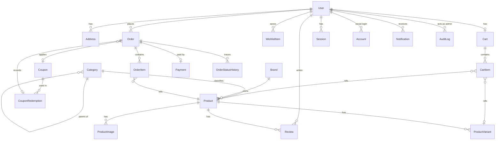
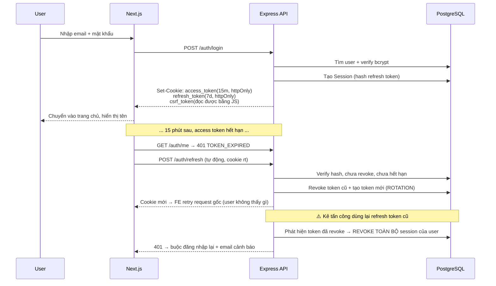

# 🏛️ KIẾN TRÚC, DATABASE & API SPEC

---

## 1. Quyết định kiến trúc (ADR tóm tắt)

### ADR-001 — Tách Frontend và Backend thành 2 service riêng
**Bối cảnh:** Next.js có API Routes, có thể làm 1 repo.
**Quyết định:** Tách `frontend/` (Next.js) và `backend/` (Express) giao tiếp qua REST.
**Lý do:** Yêu cầu đề bài là *"Backend: Node.js + REST API"*. Tách ra thể hiện rõ kỹ năng backend thuần: middleware, RBAC, error handling, rate limit — những thứ bị che khuất nếu nhúng trong Next.js. Ngoài ra cho phép scale độc lập và tái sử dụng API cho app mobile sau này.
**Đánh đổi:** Phải xử lý CORS + cookie cross-origin; deploy 2 nơi. → Chấp nhận được, và chính là điểm học tập có giá trị.

### ADR-002 — Zod dùng chung cho cả FE và BE (schema là nguồn sự thật)
Một thư mục `shared/schemas` (hoặc copy có kiểm soát) để `CreateProductSchema` giống hệt ở 2 phía → FE không bao giờ gửi payload mà BE từ chối.

### ADR-003 — Trạng thái: URL > Server > Client
**URL** là nguồn sự thật cho filter/search/pagination (chia sẻ link được, back/forward đúng).
**TanStack Query** giữ server state (cache, revalidate, optimistic).
**Zustand** chỉ giữ client state thuần (UI drawer, theme, guest cart id).

### ADR-004 — Sinh QR VietQR bằng code, không gọi API bên thứ 3
**Lý do:** Không phụ thuộc uptime/rate-limit dịch vụ ngoài; học được chuẩn EMVCo; chạy được offline; test được bằng unit test. Có fallback sang `img.vietqr.io` nếu cần.
**Đánh đổi:** Phải tự implement CRC16-CCITT và đúng spec TLV → đã có unit test bọc lại.

### ADR-005 — Tiền tệ dùng `Decimal(12,2)` trong Postgres, không dùng `Float`
`Float` gây sai số làm tròn. Mọi phép tính tiền dùng `Prisma.Decimal`; khi trả JSON thì serialize thành string để tránh mất chính xác ở JS.

### ADR-006 — Tồn kho: cột `stock` + ghi log biến động
Đơn giản, đủ dùng cho v1. Mọi thay đổi kho đều nằm trong transaction có `UPDATE ... WHERE stock >= quantity` để chống oversell khi 2 người mua cùng lúc.

---

## 2. Sơ đồ ERD (Mermaid)



---

## 3. Prisma Schema — các điểm thiết kế quan trọng

```prisma
// ─── Enum ────────────────────────────────────────────────
enum Role            { CUSTOMER ADMIN }
enum UserStatus      { ACTIVE BLOCKED DELETED }
enum OrderStatus     { PENDING_PAYMENT CONFIRMED PACKING SHIPPING DELIVERED
                       CANCELLED RETURN_REQUESTED RETURNED REFUNDED }
enum PaymentMethod   { COD BANK_TRANSFER VNPAY MOMO }
enum PaymentStatus   { UNPAID PENDING_REVIEW PAID UNDERPAID FAILED REFUNDED }
enum CouponType      { PERCENT FIXED }
enum DiscountTarget  { ALL CATEGORY PRODUCT }
```

### Quy ước chung
| Quy ước | Chi tiết |
|---|---|
| Khoá chính | `String @id @default(cuid())` — an toàn hơn auto-increment (không lộ số đơn, khó enumerate) |
| Tiền | `Decimal @db.Decimal(12, 2)` |
| Thời gian | `createdAt @default(now())`, `updatedAt @updatedAt` |
| Xoá mềm | `deletedAt DateTime?` cho Product, User, Review |
| Tên bảng | `@@map("snake_case")` để SQL gọn |
| Index | Đánh index cho: `slug` (unique), `email` (unique), `orderCode` (unique), `[categoryId, isActive]`, `[userId, status]`, `createdAt` |
| Snapshot | `OrderItem` lưu `productName`, `unitPrice`, `imageUrl` tại thời điểm mua — **giá sản phẩm đổi sau này KHÔNG làm sai hoá đơn cũ** (chi tiết rất hay để nói khi phỏng vấn) |
| JSON | `Product.specs Json?` cho thông số kỹ thuật linh hoạt; `Order.shippingAddress Json` snapshot địa chỉ |

### Các ràng buộc toàn vẹn quan trọng
```prisma
@@unique([userId, productId])          // 1 user chỉ có 1 wishlist item / sản phẩm
@@unique([orderId, productId, variantId]) // không có dòng trùng trong đơn
@@unique([userId, productId])          // 1 đánh giá / sản phẩm / user
@@unique([cartId, productId, variantId]) // không trùng dòng trong giỏ
```

---

## 4. Chuẩn API

### Base URL
```
Development:  http://localhost:4000/api/v1
Production:   https://api.domain.com/api/v1
Docs:         http://localhost:4000/api/docs  (Swagger UI)
```

### Envelope phản hồi (thống nhất mọi endpoint)
```jsonc
// ✅ Thành công
{
  "success": true,
  "message": "Lấy danh sách sản phẩm thành công",
  "data": [ /* ... */ ],
  "meta": { "page": 1, "limit": 24, "total": 128, "totalPages": 6,
            "hasNext": true, "hasPrev": false }
}

// ❌ Lỗi
{
  "success": false,
  "message": "Dữ liệu không hợp lệ",
  "code": "VALIDATION_ERROR",
  "errors": [
    { "field": "email",    "message": "Email không hợp lệ" },
    { "field": "password", "message": "Mật khẩu phải có ít nhất 8 ký tự" }
  ],
  "requestId": "req_01HXY..."
}
```

### Mã lỗi chuẩn
| HTTP | Code | Khi nào |
|---|---|---|
| 400 | `VALIDATION_ERROR` | Zod fail |
| 401 | `UNAUTHORIZED` / `TOKEN_EXPIRED` / `INVALID_CREDENTIALS` | Chưa/sai xác thực |
| 403 | `FORBIDDEN` / `ACCOUNT_BLOCKED` / `EMAIL_NOT_VERIFIED` | Không đủ quyền |
| 404 | `NOT_FOUND` | Không tìm thấy tài nguyên |
| 409 | `EMAIL_EXISTS` / `OUT_OF_STOCK` / `COUPON_INVALID` / `INVALID_STATUS_TRANSITION` | Xung đột nghiệp vụ |
| 422 | `BUSINESS_RULE_VIOLATION` | Ví dụ huỷ đơn đã giao |
| 429 | `TOO_MANY_REQUESTS` | Rate limit |
| 500 | `INTERNAL_ERROR` | Lỗi hệ thống (không leak stack ở prod) |

### Danh sách endpoint (48 endpoint)

<details>
<summary><b>Auth (14)</b></summary>

| Method | Path | Auth | Mô tả |
|---|---|---|---|
| POST | `/auth/register` | – | Đăng ký |
| POST | `/auth/login` | – | Đăng nhập |
| POST | `/auth/refresh` | cookie | Làm mới token (rotation) |
| POST | `/auth/logout` | ✅ | Đăng xuất |
| POST | `/auth/logout-all` | ✅ | Đăng xuất mọi thiết bị |
| GET | `/auth/me` | ✅ | Thông tin user hiện tại |
| GET | `/auth/verify-email` | – | Xác thực email |
| POST | `/auth/resend-verification` | ✅ | Gửi lại mail verify |
| POST | `/auth/forgot-password` | – | Yêu cầu reset |
| POST | `/auth/reset-password` | – | Đặt lại mật khẩu |
| PATCH | `/auth/change-password` | ✅ | Đổi mật khẩu |
| GET | `/auth/sessions` | ✅ | Danh sách thiết bị |
| DELETE | `/auth/sessions/:id` | ✅ | Thu hồi 1 phiên |
| GET | `/auth/google` → `/auth/google/callback` | – | OAuth Google |
</details>

<details>
<summary><b>Catalog (12)</b></summary>

| Method | Path | Auth | Mô tả |
|---|---|---|---|
| GET | `/products` | – | Danh sách + search/filter/sort/page |
| GET | `/products/suggestions?q=` | – | Autocomplete |
| GET | `/products/featured` | – | Nổi bật (trang chủ) |
| GET | `/products/best-sellers` | – | Bán chạy |
| GET | `/products/:slug` | – | Chi tiết |
| GET | `/products/:slug/related` | – | Sản phẩm liên quan |
| GET | `/categories` | – | Cây danh mục |
| GET | `/categories/:slug` | – | Chi tiết danh mục |
| GET | `/brands` | – | Thương hiệu |
| GET | `/reviews?productId=` | – | Đánh giá của sản phẩm |
| POST | `/reviews` | ✅ | Tạo đánh giá (đã mua) |
| PATCH/DELETE | `/reviews/:id` | ✅ | Sửa/xoá (trong 24h) |
</details>

<details>
<summary><b>Cart · Wishlist · Address · Coupon (14)</b></summary>

| Method | Path | Auth | Mô tả |
|---|---|---|---|
| GET | `/cart` | optional | Lấy giỏ (guest hoặc user) |
| POST | `/cart/items` | optional | Thêm sản phẩm |
| PATCH | `/cart/items/:id` | optional | Đổi số lượng |
| DELETE | `/cart/items/:id` | optional | Xoá dòng |
| DELETE | `/cart` | optional | Xoá sạch giỏ |
| POST | `/cart/merge` | ✅ | Gộp guest cart (gọi sau login) |
| GET | `/wishlist` | ✅ | Danh sách yêu thích |
| POST | `/wishlist` | ✅ | Thêm |
| DELETE | `/wishlist/:productId` | ✅ | Bỏ |
| GET/POST | `/addresses` | ✅ | Danh sách / thêm |
| PATCH/DELETE | `/addresses/:id` | ✅ | Sửa / xoá |
| PATCH | `/addresses/:id/default` | ✅ | Đặt mặc định |
| POST | `/coupons/validate` | ✅ | Kiểm tra + tính giảm giá |
| GET | `/coupons/available` | ✅ | Mã đang dùng được |
</details>

<details>
<summary><b>Order · Payment (9)</b></summary>

| Method | Path | Auth | Mô tả |
|---|---|---|---|
| POST | `/orders` | ✅ | Tạo đơn (transaction: kho + coupon + order) |
| GET | `/orders` | ✅ | Đơn của tôi |
| GET | `/orders/:orderCode` | ✅ | Chi tiết (chỉ chủ đơn) |
| POST | `/orders/:orderCode/cancel` | ✅ | Huỷ đơn |
| POST | `/orders/:orderCode/reorder` | ✅ | Mua lại |
| POST | `/orders/:orderCode/return` | ✅ | Yêu cầu trả hàng |
| GET | `/payments/:orderCode/info` | ✅ | Thông tin CK + payload QR |
| GET | `/payments/:orderCode/qr.png` | – | Ảnh QR (PNG, có thể tải về) |
| POST | `/payments/:orderCode/confirm-transfer` | ✅ | "Tôi đã chuyển khoản" |
| POST | `/webhooks/bank` | HMAC | Webhook ngân hàng (Casso/SePay) |
</details>

<details>
<summary><b>Admin (18)</b></summary>

| Method | Path | Mô tả |
|---|---|---|
| GET | `/admin/stats/overview` | 4 KPI + so sánh kỳ trước |
| GET | `/admin/stats/revenue?range=30d` | Chuỗi doanh thu theo ngày |
| GET | `/admin/stats/orders-by-status` | Donut |
| GET | `/admin/stats/top-products` | Top bán chạy |
| GET | `/admin/stats/low-stock` | Sắp hết hàng |
| GET | `/admin/stats/export?type=orders\|products\|customers` | CSV |
| GET/POST | `/admin/products` | Danh sách / tạo |
| PATCH/DELETE | `/admin/products/:id` | Sửa / xoá mềm |
| PATCH | `/admin/products/bulk` | Bulk ẩn/hiện/xoá |
| GET/POST | `/admin/categories` | CRUD danh mục |
| GET/POST | `/admin/brands` | CRUD thương hiệu |
| GET | `/admin/orders` | Tất cả đơn (filter nâng cao) |
| PATCH | `/admin/orders/:id/status` | Đổi trạng thái (validate state machine) |
| PATCH | `/admin/orders/:id/payment` | Xác nhận thanh toán thủ công |
| GET | `/admin/users` | Danh sách + filter |
| PATCH | `/admin/users/:id/status` | Khoá / mở khoá |
| PATCH | `/admin/users/:id/role` | Đổi role |
| GET/POST/PATCH/DELETE | `/admin/coupons` | CRUD mã giảm giá |
| GET/PATCH | `/admin/reviews/:id` | Duyệt / ẩn đánh giá |
| GET/PATCH | `/admin/settings` | Cấu hình shop |
</details>

---

## 5. Ví dụ Request/Response quan trọng

### `GET /products` — query đầy đủ
```http
GET /api/v1/products?q=tai+nghe&category=phu-kien&brand=sony,jbl
    &minPrice=200000&maxPrice=1000000&rating=4&inStock=true
    &sort=price_asc&page=1&limit=24
```
```jsonc
{
  "success": true,
  "data": [{
    "id": "clx...", "name": "Tai nghe Sony WH-1000XM5",
    "slug": "tai-nghe-sony-wh-1000xm5",
    "thumbnail": "/uploads/p/sony-xm5-1.webp",
    "price": "7990000.00", "salePrice": "6490000.00",
    "discountPercent": 19, "stock": 12, "avgRating": 4.7, "reviewCount": 38, "sold": 240,
    "brand": { "name": "Sony", "slug": "sony" },
    "category": { "name": "Tai nghe", "slug": "tai-nghe" },
    "isWishlisted": false
  }],
  "meta": { "page": 1, "limit": 24, "total": 47, "totalPages": 2, "hasNext": true, "hasPrev": false },
  "facets": {
    "brands":     [{ "slug": "sony", "name": "Sony", "count": 12 }],
    "priceRange": { "min": 150000, "max": 9000000 },
    "ratings":    [{ "value": 5, "count": 20 }]
  }
}
```

### `POST /orders` — tạo đơn (rút gọn logic service)
```ts
// Toàn bộ trong 1 transaction để chống oversell & sai tiền
return prisma.$transaction(async (tx) => {
  const cart = await tx.cart.findUnique({ where: { userId }, include: { items: { include: { product: true, variant: true } } } });
  if (!cart?.items.length) throw new AppError(400, 'Giỏ hàng trống');

  // 1) Kiểm tra & trừ kho bằng điều kiện nguyên tử
  for (const item of cart.items) {
    const res = await tx.$executeRaw`
      UPDATE product_variants SET stock = stock - ${item.quantity}
      WHERE id = ${item.variantId} AND stock >= ${item.quantity}`;
    if (res === 0) throw new AppError(409, `"${item.product.name}" không đủ hàng`, 'OUT_OF_STOCK');
  }

  // 2) Tính tiền lại ở server — KHÔNG tin số client gửi lên
  const subtotal = cart.items.reduce((s, i) => s.plus(unitPrice(i).times(i.quantity)), new Decimal(0));
  const shippingFee = subtotal.gte(FREE_SHIP_THRESHOLD) ? 0 : SHIPPING_FEE;
  const { discount, coupon } = await applyCoupon(tx, couponCode, subtotal);
  const total = subtotal.plus(shippingFee).minus(discount);

  // 3) Tạo order + items (snapshot) + history + payment
  const order = await tx.order.create({ data: { ... } });

  // 4) Ghi nhận coupon đã dùng + xoá giỏ
  // 5) Trả về orderCode để FE điều hướng
});
```

### `POST /webhooks/bank` — đối soát tự động
```ts
// 1) Verify chữ ký HMAC-SHA256 từ header, so sánh timing-safe
// 2) Bóc nội dung CK, regex tìm mã đơn: /DH\d{8}\d{5}/
// 3) Tìm order + payment theo transferCode
// 4) So sánh amount:
//      amount >= total  → PAID, order CONFIRMED, gửi email, ghi history
//      amount <  total  → UNDERPAID, notify admin
//      không thấy mã    → log lại vào bảng UnmatchedTransaction, trả 200 (để bank không retry vô hạn)
// 5) Idempotent: nếu payment đã PAID rồi → trả 200 luôn, không xử lý lại
```

---

## 6. Luồng xác thực (sequence)



---

## 7. Ghi chú triển khai quan trọng

| Vấn đề | Cách xử lý |
|---|---|
| **CORS + cookie cross-origin** (FE :3000, BE :4000) | `cors({ origin: CORS_ORIGIN, credentials: true })` + FE `credentials: 'include'`. Ở prod: FE và API **phải cùng site** (ví dụ `www.x.com` + `api.x.com` với `COOKIE_DOMAIN=.x.com`) hoặc dùng `SameSite=None; Secure` |
| **CSRF** | Double-submit cookie: BE set `csrf_token` (không httpOnly), FE đọc và gửi lại qua header `x-csrf-token` trong mọi request POST/PATCH/DELETE. BE so sánh bằng `crypto.timingSafeEqual` |
| **Prisma + serverless** | Dùng connection pooler (Neon pgbouncer / Supabase pooler) và `connection_limit=1` để không cạn connection |
| **Tiền tệ** | `Prisma.Decimal` khi tính, `string` khi trả JSON. FE format bằng `Intl.NumberFormat('vi-VN', { style: 'currency', currency: 'VND' })` |
| **N+1 query** | Luôn dùng `include`/`select` có chủ đích; bật log `query` của Prisma khi dev để soi |
| **Search tiếng Việt** | Migration thêm `CREATE EXTENSION IF NOT EXISTS unaccent; CREATE EXTENSION IF NOT EXISTS pg_trgm;` + index GIN trên `unaccent(name)`. Query dùng `unaccent(name) ILIKE unaccent(%q%)` → gõ không dấu vẫn ra |
| **Ảnh upload** | Multer memory storage → `sharp` resize 3 kích cỡ (thumb 300, card 600, detail 1200) → WebP → lưu storage. Trả về object `{ thumb, card, detail }` |
| **Ảnh fallback** | `next/image` với `placeholder="blur"` + `blurDataURL` sinh từ sharp (base64 10px) — chi tiết nhỏ nhưng nhìn rất chuyên nghiệp |
