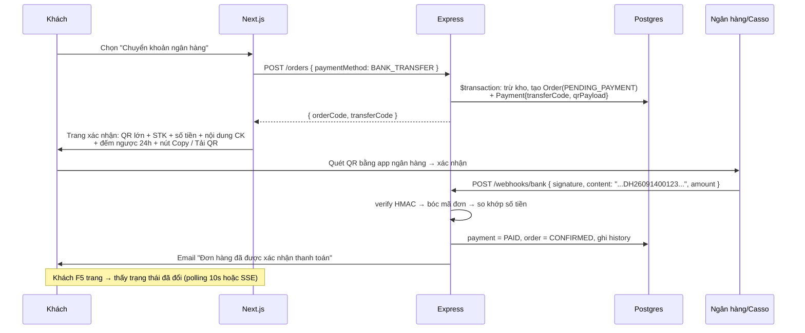

# 🔐 BẢO MẬT & TÍCH HỢP (thanh toán QR · email · mạng xã hội)

---

# PHẦN 1 — BẢO MẬT

## 1.1 Mô hình mối đe doạ (STRIDE rút gọn)

| Mối đe doạ | Kịch bản thực tế | Biện pháp trong dự án |
|---|---|---|
| **Spoofing** | Giả mạo người dùng khác | JWT ký HS256 + secret 128 hex; refresh rotation |
| **Tampering** | Sửa giá sản phẩm trong request | **Server luôn tính lại tiền** từ DB, không nhận `price`/`total` từ client |
| **Repudiation** | Chối "tôi không đặt đơn này" | `OrderStatusHistory` + `AuditLog` ghi mọi thay đổi, có IP + userAgent |
| **Information Disclosure** | Xem đơn của người khác (IDOR) | Mọi query có `where: { userId: req.user.id }`; `requireOwner` middleware |
| | Lộ email tồn tại qua API quên mật khẩu | Luôn trả cùng 1 thông báo + cùng thời gian phản hồi |
| | Stack trace lộ ra client | `errorHandler` che ở `NODE_ENV=production` |
| **Denial of Service** | Spam login / upload | `express-rate-limit` + Redis store; giới hạn kích thước body 1MB; upload 5MB, tối đa 10 file |
| **Elevation of Privilege** | User tự đổi `role` thành ADMIN | `role` **không** nằm trong danh sách field cho phép update của user; chỉ `/admin/users/:id/role` |

## 1.2 Luồng token — chi tiết triển khai

```
Access Token  : JWT HS256, TTL 15 phút, payload { sub, role, sid }, lưu trong httpOnly cookie
Refresh Token : 64 byte random → SHA-256 → lưu DB (Session.tokenHash). TTL 7 ngày.
                Cookie httpOnly, path=/api/v1/auth/refresh  ← giảm bề mặt tấn công
```

**Rotation + phát hiện tái sử dụng (reuse detection):**
```
Session {
  id, userId, tokenHash, family (uuid), userAgent, ip,
  expiresAt, revokedAt?, replacedBySessionId?, lastUsedAt
}
```
- Mỗi lần refresh: tạo session mới cùng `family`, đánh dấu session cũ `revokedAt` + `replacedBySessionId`.
- Nếu nhận refresh token mà session tương ứng **đã có `revokedAt`** → đây là tấn công (token bị đánh cắp) → **revoke toàn bộ session cùng `family`** + gửi email cảnh báo "Có đăng nhập bất thường".
- Lưu **hash** chứ không lưu token thô: nếu DB rò rỉ, kẻ tấn công không dùng được token.

**Vì sao không lưu access token trong localStorage?** → XSS đọc được. httpOnly cookie thì JS không đọc được. Đánh đổi là phải xử lý CSRF — đã xử lý bằng double-submit token.

## 1.3 Checklist OWASP Top 10 (2021) — tự chấm trước khi deploy

```
A01 Broken Access Control
  [x] RBAC middleware ở mọi route admin
  [x] Kiểm tra quyền sở hữu (IDOR) — đơn hàng, địa chỉ, đánh giá, wishlist
  [x] Bảo vệ ở BACKEND, không chỉ ẩn nút ở FE
  [x] CORS whitelist đúng origin (không dùng '*')

A02 Cryptographic Failures
  [x] bcrypt cost 12; KHÔNG log mật khẩu
  [x] HTTPS bắt buộc ở prod; HSTS 1 năm
  [x] Cookie Secure + httpOnly + SameSite
  [x] Reset/verify token lưu dạng SHA-256, TTL ngắn, dùng 1 lần
  [x] Secrets trong ENV, validate lúc khởi động (fail fast nếu thiếu)

A03 Injection
  [x] Prisma parameterized (không nối chuỗi SQL)
  [x] Raw query dùng $queryRaw có tham số, không template string
  [x] Zod validate mọi input (body/query/params)
  [x] sanitize-html cho nội dung rich text; React auto-escape
  [x] Không dùng dangerouslySetInnerHTML cho nội dung người dùng

A04 Insecure Design
  [x] State machine trạng thái đơn — không cho nhảy cóc
  [x] Money & stock luôn trong $transaction
  [x] Idempotency cho webhook & refresh

A05 Security Misconfiguration
  [x] Helmet + CSP (chặn inline script lạ, chỉ cho phép domain cần thiết)
  [x] Ẩn header x-powered-by, không trả version
  [x] Không bật CORS '*' khi có credentials
  [x] Tắt chi tiết lỗi ở prod

A06 Vulnerable Components
  [x] Dependabot + npm audit trong CI
  [x] Lock file commit

A07 Identification & Authentication Failures
  [x] Policy mật khẩu mạnh + kiểm tra mật khẩu phổ biến
  [x] Rate limit login; khoá tạm sau 5 lần sai
  [x] Email verification
  [x] Revoke mọi session khi đổi/reset mật khẩu

A08 Software & Data Integrity
  [x] Verify HMAC chữ ký webhook (timing-safe)
  [x] Validate magic bytes file upload, không chỉ MIME header

A09 Logging & Monitoring Failures
  [x] pino log có requestId, level, userId
  [x] Log các sự kiện bảo mật: login fail, token reuse, đổi quyền, xoá dữ liệu
  [x] KHÔNG log password/token/PII/CCCD
  [x] Error tracking (Sentry) ở prod

A10 SSRF
  [x] Không nhận URL ảnh từ người dùng để fetch server-side
  [x] OAuth callback URL là whitelist cố định
```

## 1.4 Bộ rate limit đề xuất

| Nhóm endpoint | Window | Max | Ghi chú |
|---|---|---|---|
| Toàn cục | 15 phút | 300 / IP | |
| `/auth/login` | 15 phút | 5 / IP + 10 / email | Khoá 15' khi vượt |
| `/auth/register` | 1 giờ | 5 / IP | |
| `/auth/forgot-password` | 1 giờ | 3 / email | |
| `/orders` (POST) | 10 phút | 10 / user | Chống spam đơn |
| `/uploads` | 1 giờ | 100 / user | Rate limit thực tế trong `middlewares/rateLimit.ts` (`uploadLimiter`) |
| `/webhooks/bank` | – | Không giới hạn, dùng HMAC | |

## 1.5 Xử lý lỗi an toàn — quy tắc vàng

```ts
// ❌ TUYỆT ĐỐI TRÁNH: lộ thông tin nội bộ
res.status(500).json({ error: err.stack, query: err.meta });
res.status(400).json({ message: 'Email này không tồn tại trong hệ thống' }); // → enumeration

// ✅ LÀM ĐÚNG: thông báo hướng người dùng, chi tiết chỉ ghi log server
logger.error({ err, requestId }, 'Login failed');
res.status(400).json({ success: false, code: 'INVALID_CREDENTIALS',
                       message: 'Email hoặc mật khẩu không đúng' });
```

---

# PHẦN 2 — THANH TOÁN CHUYỂN KHOẢN & QR VIETQR

## 2.1 Chuẩn EMVCo QR — cấu trúc TLV

QR VietQR là **TLV** (Tag-Length-Value). Cấu trúc payload động (có số tiền):

| Tag | Ý nghĩa | Giá trị trong dự án |
|---|---|---|
| `00` | Payload Format Indicator | `01` |
| `01` | Point of Initiation Method | `12` (động, vì có số tiền) |
| `38` | Merchant Account Information (VietQR) | template con ↓ |
| ├ `00` | GUID | `A000000727` |
| ├ `01` | Acquirer data | template con ↓ |
| │ ├ `00` | Bank BIN | `970436` |
| │ ├ `01` | Số tài khoản | `0011000123456` |
| │ └ `02` | Service code | `QRIBFTTA` (chuyển tới tài khoản) |
| `53` | Currency | `704` (VND) |
| `54` | Transaction Amount | `499000` |
| `58` | Country Code | `VN` |
| `59` | Merchant Name | `SHOPVN` (≤25 ký tự, không dấu) |
| `60` | Merchant City | `HA NOI` |
| `62` | Additional Data | ├ `05` Reference (mã đơn) ├ `08` Purpose (nội dung CK) |
| `63` | CRC | CRC-16/CCITT-FALSE, 4 hex |

**Thuật toán CRC** (implement sẵn trong `backend/src/lib/vietqr.ts`, có unit test):
```ts
function crc16(payload: string): string {
  let crc = 0xffff;
  for (let i = 0; i < payload.length; i++) {
    crc ^= payload.charCodeAt(i) << 8;
    for (let j = 0; j < 8; j++) {
      crc = (crc & 0x8000) ? ((crc << 1) ^ 0x1021) & 0xffff : (crc << 1) & 0xffff;
    }
  }
  return crc.toString(16).toUpperCase().padStart(4, '0');
}
```

## 2.2 Mã đối soát — chìa khoá để tự động xác nhận thanh toán

```
DH + YYMMDD + 5 số ngẫu nhiên
VD: DH26091400123
```
- Độ dài 13 ký tự, **chỉ chữ + số, không dấu, không khoảng trắng** → app ngân hàng không làm hỏng.
- Duy nhất (unique index + retry nếu trùng).
- Nội dung CK đặt vào tag `62/08` → hiện trong app ngân hàng khi quét.
- Regex bóc tách ở webhook: `/\bDH\d{6}\d{5}\b/i` → chuẩn hoá uppercase rồi tìm order.

## 2.3 Luồng thanh toán chuyển khoản



## 2.4 Xử lý các trường hợp biên (bắt buộc test)

| Tình huống | Hành vi hệ thống |
|---|---|
| Chuyển **thiếu tiền** | `paymentStatus = UNDERPAID`, ghi `paidAmount`, tạo Notification cho admin, không tự xác nhận |
| Chuyển **thừa tiền** | Xác nhận bình thường + ghi chú số dư, admin xử lý hoàn thủ công |
| Chuyển **nhiều lần** cho 1 đơn | Cộng dồn; chỉ chuyển `PAID` khi tổng ≥ total |
| **2 đơn cùng nội dung** | Không thể xảy ra — transferCode duy nhất |
| Webhook gửi **trùng** (retry) | Idempotent: nếu đã `PAID` → trả 200 ngay, không xử lý lại |
| **Sai chữ ký**, giả mạo webhook | 401 + log cảnh báo + đếm số lần sai |
| Không tìm thấy mã đơn trong nội dung | Lưu vào `UnmatchedTransaction`, trả 200 (tránh retry vô hạn), admin xử lý tay |
| Quá 24h chưa CK | Cron hủy đơn, hoàn kho, gửi email |
| Khách bấm "Tôi đã chuyển khoản" nhưng chưa chuyển | `PENDING_REVIEW` → admin kiểm tra sao kê → nếu sai thì đánh dấu `FAILED` + email nhắc |

## 2.5 API dự phòng khi không có Casso/SePay

- **Ảnh QR tĩnh:** `https://img.vietqr.io/image/{BIN}-{ACCOUNT}-compact2.png?amount={A}&addInfo={C}&accountName={N}` — dùng làm fallback nếu payload tự build có vấn đề.
- **Xác nhận thủ công:** admin upload ảnh bill + bấm xác nhận → vẫn ghi đầy đủ `AuditLog`.
- **Script mô phỏng:** `npm run webhook:simulate -- --order=DH26091400123 --amount=499000` để demo luồng auto-confirm khi phỏng vấn (không cần tiền thật).

## 2.6 Mở rộng: VNPay / MoMo (v2)

Cấu trúc đã chuẩn bị sẵn interface:
```ts
interface PaymentGateway {
  createPayment(order: Order): Promise<{ redirectUrl: string; txnRef: string }>;
  verifyCallback(query: Record<string, string>): Promise<{ valid: boolean; txnRef: string; amount: number }>;
}
```
- **VNPay:** build `vnp_Params` → sort key → `HMAC-SHA512` với `vnp_HashSecret` → redirect. IPN endpoint `/webhooks/vnpay` verify checksum `vnp_SecureHash`.
- **MoMo:** POST `createPayment` với `signature = HMAC-SHA256(rawSignature, secretKey)` → nhận `payUrl` → redirect. IPN verify tương tự.

---

# PHẦN 3 — EMAIL (quên mật khẩu · xác thực · thông báo)

## 3.1 Danh sách email hệ thống

| # | Sự kiện | Nội dung | Nút CTA |
|---|---|---|---|
| 1 | Đăng ký | "Chào mừng {tên}, xác thực email để bắt đầu" | Xác thực email (TTL 24h) |
| 2 | Quên mật khẩu | "Yêu cầu đặt lại mật khẩu" | Đặt lại mật khẩu (TTL 15') |
| 3 | Mật khẩu đã đổi | "Mật khẩu của bạn vừa được thay đổi" | Nếu không phải bạn → liên hệ |
| 4 | Đơn hàng mới | Xác nhận đơn + danh sách SP + tổng tiền | Xem đơn hàng |
| 5 | **Hướng dẫn thanh toán** | QR + STK + nội dung CK + hạn 24h | Xem QR |
| 6 | **Đã nhận thanh toán** | "Chúng tôi đã nhận được 499.000đ" | Theo dõi đơn |
| 7 | Đang giao hàng | Kèm mã vận đơn | Theo dõi |
| 8 | Giao thành công | Mời đánh giá | Đánh giá sản phẩm |
| 9 | Đơn bị huỷ | Lý do + hoàn tiền (nếu có) | Mua lại |
| 10 | Cảnh báo bảo mật | "Đăng nhập bất thường từ {IP}" | Đổi mật khẩu ngay |

## 3.2 Template email
- HTML table-based (tương thích Gmail/Outlook), width 600px, inline CSS.
- Có **bản text thuần** (`text:` trong nodemailer) → tránh bị đánh spam.
- Header màu thương hiệu, footer có link huỷ đăng ký + địa chỉ.
- **Không** gửi link dạng `http://` ở prod; **không** đưa token vào URL của frontend khác origin nếu không kiểm tra `redirect` whitelist (chống open redirect).

## 3.3 Chống lạm dụng
- Token reset: random 32 byte → SHA-256 lưu DB. Gửi **token thô** qua email, so khớp bằng hash.
- Vô hiệu hoá mọi token reset cũ khi tạo token mới (chỉ token mới nhất còn hiệu lực).
- Dọn token hết hạn bằng cron hằng ngày.

---

# PHẦN 4 — LIÊN KẾT MẠNG XÃ HỘI

## 4.1 Hai nghĩa của "liên kết mạng xã hội" — làm cả hai

### (A) Đăng nhập / liên kết tài khoản qua mạng xã hội
Bảng `Account`:
```prisma
model Account {
  id                String @id @default(cuid())
  userId            String
  provider          String   // "google" | "facebook"
  providerAccountId String
  accessToken       String?  @db.Text   // nếu cần gọi API provider
  refreshToken      String?  @db.Text
  expiresAt         Int?
  @@unique([provider, providerAccountId])
}
```
Luồng OAuth (authorization code):
```
1. FE → GET /api/v1/auth/google          (BE sinh state ngẫu nhiên, lưu cookie 5')
2. Redirect tới accounts.google.com/o/oauth2/v2/auth?scope=openid email profile&state=...
3. Google → GET /api/v1/auth/google/callback?code=...&state=...
4. BE: verify state (chống CSRF OAuth) → đổi code lấy token → lấy profile
5. Tìm Account theo (provider, providerAccountId)
   ├─ Có        → đăng nhập
   ├─ Chưa, email đã tồn tại → LIÊN KẾT vào user đó (email đã verify bởi Google)
   └─ Chưa, email mới       → tạo user mới, emailVerified = true
6. Set cookie như login thường → redirect về CLIENT_URL/auth/callback?ok=1
```
> **Bảo mật:** luôn kiểm tra `state`; chỉ chấp nhận email do provider đánh dấu `email_verified`; nếu user đã đặt mật khẩu thì **không** cho phép OAuth đổi mật khẩu.

### (B) Liên kết mạng xã hội hiển thị (footer / trang liên hệ)
Lưu trong `SiteSetting` để admin tự chỉnh trong trang quản trị:
```json
{
  "social": {
    "facebook":  "https://facebook.com/shopvn",
    "instagram": "https://instagram.com/shopvn",
    "tiktok":    "https://tiktok.com/@shopvn",
    "youtube":   "https://youtube.com/@shopvn",
    "zalo":      "https://zalo.me/0901234567"
  }
}
```
Hiển thị ở: **footer** (icon hover có animation), **trang chi tiết sản phẩm** (nút chia sẻ lên Facebook/Twitter/Copy link — dùng `navigator.share` trên mobile), **trang liên hệ**, và **email** (footer).

Nút chia sẻ dùng:
```ts
const shareUrl = `${process.env.NEXT_PUBLIC_SITE_URL}/products/${slug}`;
// Facebook: https://www.facebook.com/sharer/sharer.php?u={encodeURIComponent(shareUrl)}
// Zalo:    https://zalo.me/share?u=...   |  Twitter/X: https://twitter.com/intent/tweet?url=...
// Ưu tiên navigator.share() nếu có (mobile) → fallback web intent
```

## 4.2 Bảo mật liên kết tài khoản
- Không tự động gộp tài khoản dựa trên email nếu provider không xác nhận email đã verify.
- Cho phép **huỷ liên kết** nhưng chặn nếu user chưa có mật khẩu (tránh mất quyền truy cập).
- Ghi `AuditLog` khi liên kết/huỷ liên kết.
- Rate limit endpoint OAuth callback theo IP.

---

# PHẦN 5 — QUY TRÌNH TRƯỚC KHI LÊN PRODUCTION

```
[ ] Đổi toàn bộ secret mặc định (JWT, webhook, DB, admin password)
[ ] COOKIE_SECURE=true, COOKIE_DOMAIN=.domain.com, HTTPS + HSTS
[ ] CORS_ORIGIN chỉ đúng domain FE (không '*', không localhost)
[ ] NODE_ENV=production (tắt stack trace, tắt Prisma query log)
[ ] Chạy `npm audit --production` → 0 high/critical
[ ] Rate limit dùng Redis store (không dùng MemoryStore)
[ ] Backup DB tự động hằng ngày + đã thử restore 1 lần
[ ] Sentry/Uptime monitor đã bật, có alert
[ ] Xoá tài khoản demo nếu shop thật; hoặc giữ nhưng giới hạn quyền
[ ] Kiểm thử tải nhẹ (k6 autocannon 100 req/s) trên /products
[ ] Có trang chính sách bảo mật + điều khoản (nếu là shop thật)
[ ] Kiểm tra: ảnh upload không thể thực thi (thử upload .php/.svg có script)
```
